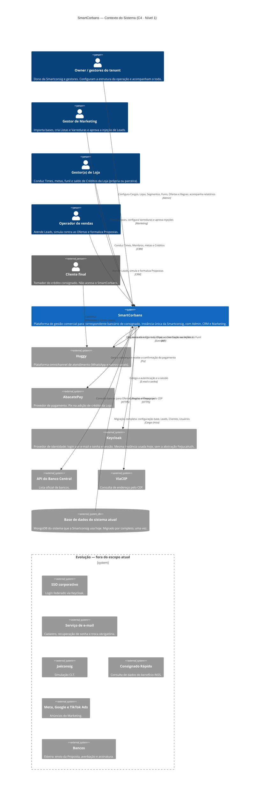

# SmartCorbans — C4 Model · Nível 1: Contexto do Sistema

**Status:** Draft
**Versão:** 0.6
**Base:** Especificação Geral v2.3 (`spec.md`) e documentos de módulo (Admin, CRM, Marketing)
**Próximo nível:** 02 — Containers

## Histórico de revisões

| Versão | Mudanças |
|---|---|
| 0.6 | **Inclui o ViaCEP** como sistema externo ativo: autopreenchimento de endereço pelo CEP na ficha do Cliente (CRM · Clientes RN-CLI-07). Faltava desde a v0.1. |
| 0.5 | **Inclui a API do Banco Central** como sistema externo ativo: fonte da lista de bancos em Ofertas, Regras (RN-RGR-03) e Propostas (RN-PRP-14). Faltava desde a v0.1. Registra que a troca de senha pelo próprio usuário já existe no Shell Privado. |
| 0.4 | **Decisões do usuário (§6):** D-07: o SmartCorbans **reaproveita o Keycloak e a base de identidade já usados hoje**, removendo a abstração FeijucaAuth; usuários e senhas não precisam ser recriados. O mapeamento da migração fica para o plano de migração, fora deste documento. Itens abertos 1 e 2 fechados. |
| 0.3 | **Decisões do usuário (§6):** (5) D-05: a **senha do novo usuário é definida por quem o cadastra**; o usuário troca quando quiser, sem obrigatoriedade no primeiro login, e não há e-mails de cadastro ou recuperação (vai para Evolução). (6) D-06: a **migração é completa** (configuração base, Leads, Clientes, Usuários etc.), ainda numa carga única a partir da base atual. Itens abertos de senha inicial e escopo da migração fechados; entra o item de senhas dos usuários migrados. |
| 0.2 | **Decisões do usuário (§6):** (1) **Keycloak** é o provedor de identidade; **SSO corporativo não entra** agora e vai para Evolução. (2) Da transição, **só a base de dados do sistema atual** é migrada. (3) **Recuperação de senha e primeiro acesso não entram** nesta primeira versão; com isso, sai o item aberto de e-mail transacional. (4) **AbacatePay** é o provedor de pagamento, **só com Pix** no início; Boleto vai para Evolução. |
| 0.1 | Primeira versão do diagrama de contexto, derivada da Especificação Geral v2.3. |

---

## 1. Escopo do diagrama

O diagrama de contexto mostra o **SmartCorbans como uma caixa só**, as **pessoas** que o usam e os **sistemas externos** com que ele conversa. Não mostra aplicações, serviços nem banco de dados próprios: isso é o nível 2 (Containers).

Premissas tiradas da spec:

- **Instância única (single-tenant)** da Smartconsig. Parceiros entram como **Lojas**, não como tenants (spec §1.1, §3.3).
- As três aplicações (Admin, CRM e Marketing) e o Shell compartilhado ficam **dentro** da caixa do SmartCorbans. Aparecem como rótulo nas relações, para indicar por onde cada pessoa entra.
- O **cliente final** (tomador do consignado) **não usa o SmartCorbans**: conversa pela Huggy. Não há portal do cliente (spec §3.2).

## 2. Diagrama

Uma versão desenhada do diagrama, com a mesma informação, está publicada como página.

## 3. Elementos

### 3.1. Pessoas

| Elemento | Quem é | Por onde entra | Origem na spec |
|---|---|---|---|
| **Owner / gestores do tenant** | Dono da Smartconsig (papel de sistema, bypass total) e gestores com permissão no Admin. | Admin | §1.3 (Sérgio), §3.3 |
| **Gestor de Marketing** | Gera demanda acima das Lojas: Prospecção, Carteira Ativa, aprovação de injeção. | Marketing | §1.3, §2.1 |
| **Gestor(a) de Loja** | Lidera Times de operadores; acompanha metas, funil e saldo. Pode ser da Loja da Smartconsig ou de um parceiro. Escopo `store`. | CRM | §1.3 (Marina), §5 |
| **Operador de vendas** | Recebe Leads pela distribuição, conversa, simula e formaliza. Escopo típico `self`. | CRM | §1.3 (Diego) |
| **Cliente final** *(externo)* | Pessoa que toma o crédito. Fala só pela Huggy. | — | §3.2 (sem portal do cliente) |

As personas são figuras de referência, não papéis do sistema: o acesso é sempre por permissão `recurso:ação:escopo` (spec §1.3, §5). O diagrama agrupa as pessoas pelo uso típico de cada aplicação.

### 3.2. Sistema em foco

| Elemento | Descrição | Origem na spec |
|---|---|---|
| **SmartCorbans** | Plataforma SaaS de gestão comercial para correspondente bancário de consignado. Instância única da Smartconsig; parceiros são Lojas isoladas entre si. Reúne estrutura da operação (Admin), dia a dia comercial (CRM) e geração de demanda (Marketing), com um motor interno de Simulação. Web e mobile-first. | §1.1, §2, §3.3, RNF001, RNF002 |

### 3.3. Sistemas externos

| Elemento | Função | Situação | Origem |
|---|---|---|---|
| **Huggy** | Atendimento omnichannel. Origina Leads (Campanha, Orgânica, Recontato), cria Clientes, dispara a Simulação automática e é a fonte das mensagens do Chat. O SmartCorbans **não persiste mensagens**. | Ativa | spec §4.4; CRM · Chat; CRM · Leads RN-LED-12; CRM · Simulações RN-SIM-04 |
| **AbacatePay** | Provedor de pagamento da adição de crédito da Loja. **Só Pix** no início. | Ativa | spec §4.4, §10; CRM · Créditos RF-CRD-03; decisão D-04 |
| **Keycloak** | Provedor de identidade: login por e-mail e senha e gestão de sessão. Usuários são criados pelo SmartCorbans, sem cadastro público; a senha inicial é definida por quem cadastra. **É a mesma instância e base de identidade usadas hoje**, acessada diretamente, sem a abstração FeijucaAuth. | Ativa | spec §4.2; decisões D-01, D-05 e D-07 |
| **API do Banco Central** | Lista oficial de bancos. Não há cadastro de Bancos no produto: Ofertas, Regras ("Bancos não aceitos") e Propostas (banco de origem na Portabilidade) buscam daqui. | Ativa | Admin · Ofertas; Admin · Regras RN-RGR-03; CRM · Propostas RN-PRP-14 |
| **ViaCEP** | Consulta de endereço pelo CEP: preenche Logradouro, Bairro, Cidade e Estado na ficha do Cliente. Falha na consulta não bloqueia; o endereço segue manual. | Ativa | CRM · Clientes RN-CLI-07 |
| **Base de dados do sistema atual** | **MongoDB** do sistema que a Smartconsig usa hoje (ADR-0003). Fonte de uma **migração única e completa** (configuração base, Leads, Clientes, Usuários etc.); não há integração contínua. | Transição | spec §10; decisões D-02 e D-06 |
| **SSO corporativo** | Login federado, a ser configurado no Keycloak quando entrar. | Evolução | decisão D-01 |
| **Serviço de e-mail** | E-mails de cadastro, recuperação de senha e troca obrigatória no primeiro login. | Evolução | decisões D-03 e D-05 |
| **Jaéconsig** | Simulação CLT. | Evolução | spec §3.2, §11 |
| **Consignado Rápido** | Consulta de dados do benefício INSS. | Evolução | spec §3.2, §11 |
| **Meta, Google e TikTok Ads** | Anúncios e gasto de mídia no Dashboard do Marketing. | Evolução | spec §3.2, §11 |
| **Bancos** | Esteira bancária: envio da Proposta, averbação, assinatura. | Fora do escopo | spec §3.2, §11 |

## 4. Relações

| De | Para | O quê | Como |
|---|---|---|---|
| Owner / gestores do tenant | SmartCorbans | Configura Cargos, Usuários, Lojas, Segmentos, Funis, Ofertas e Regras; acompanha Dashboard e Relatórios globais | Admin |
| Gestor de Marketing | SmartCorbans | Importa bases (CSV/XLSX), cria Listas e Varreduras, aprova injeção de Leads, acompanha o retorno | Marketing |
| Gestor(a) de Loja | SmartCorbans | Conduz Times, Membros, metas, Rankings e Créditos; edita o recorte da própria Loja | CRM |
| Operador de vendas | SmartCorbans | Trabalha Leads no kanban, conversa no Chat, simula e formaliza a Proposta | CRM |
| Cliente final | Huggy | Conversa com a operação | WhatsApp e outros canais |
| Huggy | SmartCorbans | Cria Lead e Cliente na entrada; dispara a Simulação automática quando o fluxo obtém os dados | Eventos |
| SmartCorbans | Huggy | Lê e envia mensagens do Chat em tempo real; aciona fluxos da Huggy nas Ações do Funil, sem bloquear a Ação | API |
| SmartCorbans | AbacatePay | Gera a cobrança Pix e recebe a confirmação, que credita o saldo da Loja | Pix |
| SmartCorbans | Keycloak | Delega a autenticação e a sessão dos usuários | E-mail e senha |
| SmartCorbans | API do Banco Central | Consulta a lista de bancos | HTTPS |
| SmartCorbans | ViaCEP | Consulta endereço pelo CEP | HTTPS |
| Base de dados do sistema atual | SmartCorbans | Migração completa: configuração base, Leads, Clientes, Usuários etc. | Carga única |

## 5. Regras de contexto

- **Degradação graciosa (RNF004).** Huggy, AbacatePay, a API do Banco Central ou o ViaCEP fora do ar não derrubam o SmartCorbans. No Chat não há alternativa local, porque as mensagens não são persistidas. O Keycloak é dependência crítica: sem ele não há login.
- **Isolamento entre Lojas (RNF002).** É um limite **interno** ao sistema, não uma fronteira de contexto: todas as Lojas, inclusive as dos parceiros, estão na mesma instância.
- **Sem cadastro público.** Usuários são criados por quem tem permissão; não há relação de autoatendimento com o mundo externo (§4.2).
- **Templates, fluxos e tags vivem na Huggy.** O SmartCorbans referencia, não modela (CRM · Chat; Admin · Funis RN-FNL-04).

## 6. Decisões registradas

| ID | Data | Decisão | Efeito no contexto |
|---|---|---|---|
| D-01 | 2026-10-10 | **Keycloak** é o provedor de identidade. **SSO corporativo não entra** no momento. | Keycloak entra como sistema externo ativo; SSO vai para Evolução. Fecha o item 1 da spec §12 quanto ao provedor. |
| D-02 | 2026-10-10 | Da transição, **só a base de dados do sistema atual** é migrada. | A relação com o sistema atual é uma carga única a partir do banco, sem integração contínua. Responde ao item 2 da spec §12 quanto ao caminho. |
| D-03 | 2026-10-10 | **Recuperação de senha e primeiro acesso não entram** nesta primeira versão. | Não há serviço de e-mail transacional no contexto. |
| D-04 | 2026-10-10 | **AbacatePay** é o provedor de pagamento, **só com Pix** no início. | O gateway vira AbacatePay; Boleto vai para Evolução. Afeta CRM · Créditos RF-CRD-03, que hoje prevê Pix e Boleto. |
| D-05 | 2026-10-10 | O usuário que cadastra (A) **define a senha** do novo usuário (B). B **troca quando quiser**, sem obrigatoriedade no primeiro login. Não há e-mail de cadastro, recuperação ou troca obrigatória. | Nenhum serviço de e-mail no contexto. Troca obrigatória e e-mails viram nota de evolução. Fecha o item aberto de senha inicial. |
| D-06 | 2026-10-10 | A migração leva **todos os dados** do sistema atual: configuração base, Leads, Clientes, Usuários etc. | A carga única passa a ser completa, não só de Clientes e contratos. Fecha o item aberto de escopo da migração. |
| D-07 | 2026-10-10 | O sistema atual já usa o **Keycloak**, por trás da abstração **FeijucaAuth**. O SmartCorbans **reaproveita a mesma base do Keycloak**, acessando-o diretamente e removendo a abstração. | Usuários e senhas continuam no Keycloak e não passam pela carga única; a migração de Usuários cobre só os dados do lado do SmartCorbans (Cargo, Loja, Time etc.). Fecha o item aberto de senhas dos usuários migrados. |

> **Complemento de D-07** (ver ADR-0001): hoje há um realm por parceiro. O SmartCorbans usa **um realm único**, em que **cada Loja é uma Organização** do Keycloak; os realms atuais são consolidados na migração, preservando as senhas.

**Aplicado nos documentos (10/10/2026):** Especificação Geral v2.4 (§3.2, §4.2, §4.4, RNF004, §8, §10, §11 e §12); Admin · Usuários v0.7 (RF-USR-03, RN-USR-08, sem o estado Convidado); CRM · Membros v0.5; CRM · Créditos v0.6 e sua Matriz v0.3 (só Pix, AbacatePay); Admin · Lojas v0.15; Admin · Relatórios v0.7; CRM · Relatórios v0.5; CRM · Documento de Produto v0.2. A troca de senha pelo próprio usuário (RF-USR-03) já existe no menu da conta do Shell Privado; nada a ajustar lá.

## 7. Pontos em aberto que afetam o contexto

1. **Landing Pages (Marketing V2).** Quando entrarem, passam a originar Leads e Clientes e devem aparecer no contexto.

O **mapeamento da migração** (como os conceitos do sistema atual viram Cargos, Lojas, Times, Segmentos e Funis) será tratado no plano de migração, no momento da execução, e não neste documento.

## 8. Notas de evolução registradas aqui

- **E-mails do ciclo de acesso:** e-mail de cadastro, recuperação de senha e troca obrigatória de senha no primeiro login (D-03, D-05).
- **SSO corporativo** via Keycloak (D-01).
- **Boleto** no AbacatePay (D-04).

## 9. Próximo nível

O nível 2 (Containers) abre a caixa do SmartCorbans: as três aplicações web sobre o Shell compartilhado, a(s) API(s), o motor de Simulação, a distribuição de Leads, os bancos de dados e os pontos de integração com Huggy, AbacatePay e Keycloak. As decisões de tecnologia desse nível ainda não estão na spec e precisam ser tomadas antes do desenho.
