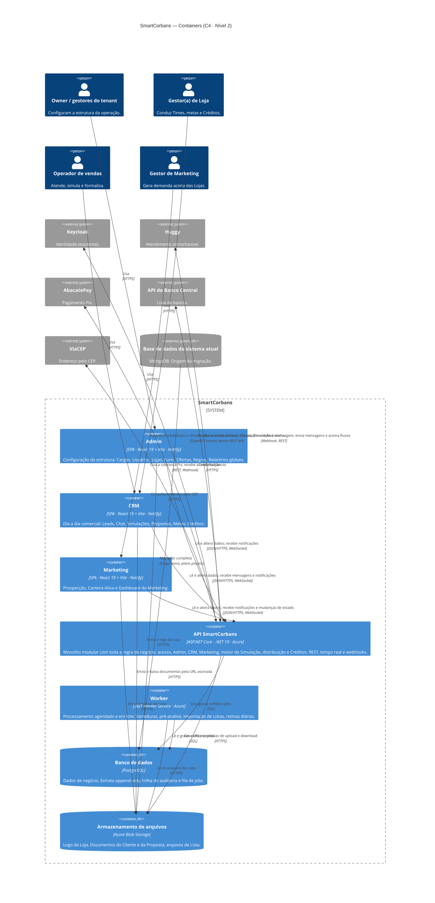

# SmartCorbans — C4 Model · Nível 2: Containers

**Status:** Draft
**Versão:** 0.6
**Base:** C4 · Nível 1 (`01-contexto.md` v0.6), Especificação Geral v2.4 e documentos de módulo
**Nível anterior:** 01 — Contexto · **Próximo nível:** 03 — Componentes

## Histórico de revisões

| Versão | Mudanças |
|---|---|
| 0.6 | **Admin também recebe notificações em tempo real** (ADR-0025); o sino é único entre as três aplicações. |
| 0.5 | Novo container **Armazenamento de arquivos** (Azure Blob Storage, ADR-0024): logo da Loja, Documentos do Cliente e da Proposta, arquivos de Lista do Marketing. |
| 0.4 | Inclui o **ViaCEP** (C4 · Contexto v0.6), consultado pela API. |
| 0.3 | **Premissas P-01 a P-06 fechadas** (ADR-0005 a ADR-0011): API com réplica única (ADR-0009); tempo real também no Marketing (ADR-0015); base atual identificada como MongoDB (ADR-0003). |
| 0.2 | **Decisões do usuário (§5):** D-09, o **login passa pela API**: a tela de login envia as credenciais à API, que autentica no Keycloak; as aplicações web não falam com o Keycloak. D-10, o banco é **PostgreSQL**. D-11, **backend na Azure** e **front na Netlify**. Saem as relações das aplicações com o Keycloak e os três itens abertos. |
| 0.1 | Primeira versão. Abre a caixa do SmartCorbans em seis containers: três aplicações web, API, Worker e banco de dados. As escolhas de tecnologia que a spec ainda não fixa estão marcadas como **premissa** (§6). |

---

## 1. Escopo do diagrama

O nível 2 abre a caixa do SmartCorbans e mostra as **unidades que rodam separadamente** (aplicações, serviços e armazenamento), como elas conversam entre si e com os sistemas externos do nível 1.

- **Fora deste nível:** a organização interna de cada container (módulos, camadas, pacotes do monorepo). Isso é o nível 3 (Componentes).
- **Pessoas:** as quatro do nível 1 que usam o sistema. O cliente final não aparece, porque só fala com a Huggy.
- **Sistemas em Evolução** (SSO, e-mail, Jaéconsig, Consignado Rápido, Ads, Bancos) não aparecem, porque nenhum container depende deles nesta versão.

## 2. Diagrama

Uma versão desenhada do diagrama está publicada como página.

## 3. Containers

| Container | Tecnologia | Responsabilidade | Origem |
|---|---|---|---|
| **Admin** | SPA · React 19, Vite, TypeScript · hospedada na Netlify | Configuração da estrutura da operação (15 módulos do Admin). Só apresentação: toda regra vive na API. | spec §2.1, §9.1 |
| **CRM** | SPA · React 19, Vite, TypeScript · hospedada na Netlify | Operação comercial das Lojas (14 módulos do CRM). Mantém conexão em tempo real com a API para o Chat e notificações. | spec §2.1, §9.2; CRM · Chat |
| **Marketing** | SPA · React 19, Vite, TypeScript · hospedada na Netlify | Prospecção, Carteira Ativa e Dashboard. Envia as Listas (CSV/XLSX) para a API. | spec §2.1, §9.3 |
| **API SmartCorbans** | ASP.NET Core · .NET 10 *(ADR-0005, ADR-0006)* · Azure | Única porta de entrada das três aplicações, **inclusive para o login** (D-09). Concentra a regra de negócio: permissões e isolamento entre Lojas, cadastros, Funis, motor de Simulação (o mesmo para CRM e Marketing), distribuição em duas camadas, Créditos, Propostas, Metas. Recebe os webhooks da Huggy e do AbacatePay e publica eventos em tempo real para o CRM e o Marketing (ADR-0010, ADR-0015). | spec §2.2, §3.3, RN-SC-01 a 09 |
| **Worker** | .NET Worker Service *(ADR-0007)* · Azure | Tudo o que roda fora de uma requisição: Varredura Recorrente às 00h (RN-CRA-08), simulação em lote da pré-análise (RN-CRA-02, Prospecção), importação e validação de Listas, injeção de Leads aprovadas respeitando o limite diário, virada diária do Limite de gasto (RN-CRD-07). | Marketing · Carteira Ativa e Prospecção; CRM · Créditos |
| **Banco de dados** | PostgreSQL (D-10) · Azure | Fonte única dos dados de negócio. Guarda o Extrato append-only (RN-CRD-06), a trilha de auditoria (RNF005) e a fila de jobs consumida pelo Worker. Não guarda mensagens do Chat (vivem na Huggy) nem credenciais (vivem no Keycloak). | spec §3.3; CRM · Chat; D-07 |
| **Armazenamento de arquivos** | Azure Blob Storage *(ADR-0024)* · Azure | Arquivos que não são dado de tabela: logo da Loja, Documentos do Cliente e da Proposta, arquivos de Lista e da Lista de bloqueio. Privado; o banco guarda só a chave e os metadados. |

**O Shell não é container.** Sidebar, header, app switcher e menu da conta são pacotes do monorepo compilados dentro de cada aplicação (spec §4.1). O app switcher navega entre três aplicações distintas.

## 4. Relações

| De | Para | O quê | Como |
|---|---|---|---|
| Owner / gestores | Admin | Configura e acompanha | HTTPS (navegador) |
| Gestor(a) de Loja, Operador | CRM | Opera o dia a dia | HTTPS (navegador) |
| Gestor de Marketing | Marketing | Gera demanda | HTTPS (navegador) |
| Admin, CRM, Marketing | API | Login: enviam e-mail e senha e recebem os tokens; logout e renovação de sessão | JSON/HTTPS |
| Admin | API | Lê e altera dados; recebe notificações (ADR-0025) | JSON/HTTPS, com o token emitido pelo Keycloak, e WebSocket |
| Marketing | API | Lê e altera dados; recebe notificações e mudanças de estado de Listas e Varreduras (ADR-0015) | JSON/HTTPS e WebSocket |
| CRM | API | Lê e altera dados; recebe mensagens novas do Chat e notificações | JSON/HTTPS e WebSocket *(ADR-0010)* |
| API | Keycloak | Troca as credenciais do login por tokens e os renova; valida tokens; cria usuário, define e redefine senha, inativa e revoga sessões (RF-USR-01 a 03, RN-USR-05) | OpenID Connect (token endpoint, JWKS) e Admin REST API |
| Huggy | API | Cria Lead e Cliente, dispara a Simulação automática, avisa mensagem nova | Webhook |
| API | Huggy | Lê o histórico da conversa, envia mensagens e Templates, aciona fluxos nas Ações do Funil | REST |
| API | AbacatePay | Cria a cobrança Pix | REST |
| AbacatePay | API | Confirma o pagamento, que credita o saldo | Webhook |
| API | API do Banco Central | Consulta a lista de bancos | HTTPS |
| API | ViaCEP | Consulta endereço pelo CEP | HTTPS |
| API | Banco de dados | Lê e grava; enfileira jobs | SQL |
| Worker | Banco de dados | Lê e grava; consome jobs | SQL |
| API | Armazenamento de arquivos | Confere permissão e gera URL assinada de curta duração para upload e download *(ADR-0024)* | HTTPS, Managed Identity |
| Admin, CRM, Marketing | Armazenamento de arquivos | Enviam e baixam o arquivo direto, pela URL assinada | HTTPS |
| Worker | Armazenamento de arquivos | Lê os arquivos de Lista e da Lista de bloqueio para importar | HTTPS, Managed Identity |
| Base do sistema atual (MongoDB) | Banco de dados | Migração completa, com transformação de documento para relacional (ADR-0003) | Carga única (D-06, D-08) |

## 5. Decisões já tomadas que o diagrama segue

- **Instância única** (spec §1.1): uma API e um banco para toda a operação; as Lojas são separadas por regra na API, não por infraestrutura (RNF002).
- **Três aplicações** (spec §2.1), no **monorepo** pnpm + Turborepo, cada uma uma SPA Vite + React, com Shell e design system em pacotes compartilhados.
- **Keycloak existente, sem FeijucaAuth** (D-07): só a API fala com o Keycloak.
- **D-09 — Login pela API** (2026-10-10). A tela de login (Shell Público) envia as credenciais à API, que as autentica no Keycloak e devolve os tokens. As aplicações web não falam com o Keycloak.
- **D-10 — PostgreSQL** (2026-10-10) é o banco de dados.
- **D-11 — Hospedagem** (2026-10-10): backend (API, Worker, banco) na **Azure**; aplicações web na **Netlify**. Consequência: as SPAs e a API ficam em domínios diferentes, então a API precisa de CORS para os três domínios das aplicações. O serviço específico de cada container na Azure entra no diagrama de implantação.
- **Mensagens do Chat não são persistidas** (CRM · Chat): a API repassa, não armazena.
- **Um só motor de Simulação** (RN-SC-03): vive na API e é reaproveitado pelo Worker na pré-análise em lote, com o mesmo código.

## 6. Premissas deste nível

Escolhas que a spec não fixa. Foram adotadas para o diagrama poder ser desenhado; cada uma pode ser trocada sem mudar o nível 1.

| ID | Premissa | Por quê |
|---|---|---|
| ~~P-01~~ | **Decidida: [ADR-0005](../ADR/ADR-0005-dotnet-10.md)** — .NET 10, Clean Architecture e CQRS. | — |
| ~~P-02~~ | **Decidida: [ADR-0006](../ADR/ADR-0006-monolito-modular.md)** — uma API, monolito modular. | — |
| ~~P-03~~ | **Decidida: [ADR-0007](../ADR/ADR-0007-worker-separado.md)** — Worker separado, com o mesmo código de domínio. | — |
| ~~P-04~~ | **Decidida: [ADR-0008](../ADR/ADR-0008-fila-de-jobs-no-postgresql.md)** — fila de jobs no PostgreSQL, sem broker. | — |
| ~~P-05~~ | **Decidida: [ADR-0010](../ADR/ADR-0010-tempo-real-signalr.md)** — SignalR na API, sem backplane, com réplica única ([ADR-0009](../ADR/ADR-0009-api-replica-unica.md)). | — |
| ~~P-06~~ | **Decidida: [ADR-0011](../ADR/ADR-0011-webhooks-na-api.md)** — webhooks recebidos pela própria API. | — |

## 7. Pontos em aberto deste nível

Nenhum. O serviço Azure de cada container (App Service, Container Apps, Azure Database for PostgreSQL etc.) é detalhe do diagrama de implantação.

## 8. Próximo nível

O nível 3 (Componentes) detalha a **API SmartCorbans**: os módulos de domínio, como se isolam e como o motor de Simulação e a distribuição são compartilhados com o Worker. As aplicações web seguem a arquitetura Feature-Based já documentada no monorepo e só ganham diagrama próprio se for útil.
