# SmartCorbans — C4 Model · Nível 3: Componentes do Admin (UI)

**Status:** Draft
**Versão:** 0.3
**Base:** C4 · Nível 2 (`02-containers.md` v0.2), Admin — Documento de Produto e documentos de módulo do Admin, arquitetura Feature-Based do monorepo
**Nível anterior:** 02 — Containers · **Par:** 03 — Componentes da API

## Histórico de revisões

| Versão | Mudanças |
|---|---|
| 0.3 | **O Admin ganha o Tempo real** (ADR-0025): recebe notificações na hora, e o sino do Shell é único entre as três aplicações. |
| 0.2 | §7 corrigida após ler a skill do monorepo: as cinco adaptações já estavam resolvidas. Pacotes `shells`, `users` e `notifications` incluídos. Convenção de nome de pasta registrada em `naming.md`. |
| 0.1 | Primeira versão. Abre o container **Admin** em componentes de aplicação, 14 features (uma por módulo de produto, com Layout de Lead dentro de Funis, agrupadas pelas seis seções da navegação) e os pacotes compartilhados do monorepo. |

---

## 1. Escopo do diagrama

Este nível abre o container **Admin** (SPA · React 19 + Vite, hospedada na Netlify) e mostra seus componentes.

- **Pacotes do monorepo** (Shell, Auth, Permissões, Design system, HTTP client, modelos) são compilados dentro do Admin. Aparecem dentro da fronteira, separados das features, porque o CRM e o Marketing usam os mesmos.
- **Fora deste nível:** a estrutura interna de cada feature (`presentation/domain/data`), que segue a arquitetura Feature-Based já documentada no monorepo.
- O Admin só fala com a **API SmartCorbans** (D-09): login, dados e trocas de senha passam por ela, e recebe as notificações pelo hub de tempo real (ADR-0025).

## 2. Diagrama

```mermaid
C4Component
  title Admin (UI) — Componentes (C4 · Nível 3)

  Person(owner, "Owner e gestores do tenant", "Configuram a estrutura da operação.")
  Container(api, "API SmartCorbans", "ASP.NET Core · Azure")

  Container_Boundary(admin, "Admin · SPA React 19 + Vite · Netlify") {
    Component(router, "Rotas e guarda de permissão", "apps/admin · app", "Rotas por seção; bloqueia a rota sem permissão e mostra o estado sem acesso.")
    Component(shell, "Shell Privado", "pacote do monorepo", "Sidebar, header, app switcher, notificações, menu da conta.")
    Component(providers, "Bootstrap e providers", "apps/admin · app", "QueryClient com MutationCache (toast único), tema, HTTP client configurado.")

    Component(roles, "Cargos", "feature roles")
    Component(users, "Usuários", "feature users")
    Component(dashboard, "Dashboard", "feature dashboard")
    Component(reports, "Relatórios", "feature reports")
    Component(stores, "Lojas e Times", "feature stores")
    Component(funnels, "Funis de Vendas + Layout de Lead", "feature funnels")
    Component(segments, "Segmentos", "feature segments")
    Component(products, "Produtos", "feature products")
    Component(promoters, "Promotoras", "feature promoters")
    Component(regions, "Regiões", "feature regions")
    Component(statuses, "Status de Proposta", "feature proposal-statuses")
    Component(origins, "Origem de Venda", "feature sale-origins")
    Component(offers, "Ofertas", "feature offers")
    Component(rules, "Regras", "feature rules")

    Component(auth, "Auth", "packages/core/features/auth", "Login e renovação pela API; sessão.")
    Component(perms, "Permissões", "packages/core/features/permissions", "Permissões efetivas, escopo, checagem na UI.")
    Component(ui, "Design system", "packages/ui + packages/tokens", "shadcn/ui, React Aria, tokens.")
    Component(http, "HTTP client", "packages/infra", "Cliente com getToken e onUnauthorized injetados.")
    Component(rt, "Tempo real", "pacote compartilhado · cliente SignalR", "Recebe notificações para o sino.")
  }

  Rel(owner, shell, "Usa", "HTTPS")
  Rel(shell, router, "Navega")
  Rel(router, perms, "Checa permissão da rota")
  Rel(offers, rules, "Associa Regras", "index.ts")
  Rel(offers, products, "Seleciona Produto", "index.ts")
  Rel(offers, promoters, "Seleciona Promotora", "index.ts")
  Rel(users, roles, "Seleciona Cargo", "index.ts")
  Rel(users, stores, "Seleciona Loja e Time", "index.ts")
  Rel(stores, regions, "Seleciona Região", "index.ts")
  Rel(stores, segments, "Seleciona Segmentos", "index.ts")
  Rel(auth, http, "Login e renovação")
  Rel(http, api, "Chamadas", "JSON/HTTPS, Bearer")
  Rel(rt, api, "Recebe notificações", "WebSocket")
  Rel(rt, shell, "Atualiza o sino")
```

O diagrama Mermaid mostra só algumas dependências entre features. A lista completa está na §4. A versão desenhada está publicada como página.

## 3. Componentes

### 3.1. Componentes da aplicação (`apps/admin`)

| Componente | Responsabilidade |
|---|---|
| **Bootstrap e providers** | Monta o `QueryClient` com o **`MutationCache` como ponto único de toast de erro**, o tema (claro e escuro), o roteador e o HTTP client com `getToken` e `onUnauthorized` vindos de Auth. |
| **Rotas e guarda de permissão** | Declara as rotas das seis seções. Cada rota exige uma permissão do catálogo do Admin (ex.: `offers:view`); sem ela, mostra o estado "sem acesso" do Shell. Telas seguem a hierarquia **página → sheet → dialog**; telas densas de configuração (ex.: permissões de um Cargo) são páginas. |
| **Shell Privado** *(pacote)* | Sidebar, header, app switcher, notificações, toasts e menu da conta (inclui trocar senha, RF-USR-03). A sidebar **oculta** o que o usuário não pode usar, lendo Permissões. |

### 3.2. Features (uma por módulo de produto)

Organizadas pelas seis seções da navegação do Admin (Admin, Documento de Produto, §1). O nome da pasta segue o **recurso do catálogo de permissões** *(convenção da skill do monorepo, ex-P-10)*.

| Seção | Feature | Pasta | Permissões (recurso) | Módulo de domínio na API |
|---|---|---|---|---|
| Acesso | **Cargos** | `roles` | `roles` | Acesso |
| Acesso | **Usuários** (com sessões) | `users` | `users`, `sessions` | Acesso |
| Visão geral | **Dashboard** | `dashboard` | `view` do módulo de cada bloco | Desempenho |
| Vendas | **Lojas e Times** (com Créditos da Loja) | `stores` | `stores`, `teams` | Estrutura, Créditos |
| Vendas | **Funis de Vendas**, com **Layout de Lead** como 6ª aba | `funnels` | `funnels` | Funis |
| Cadastros | **Segmentos** | `segments` | `segments` | Estrutura |
| Cadastros | **Produtos** | `products` | `products` | Catálogo comercial |
| Cadastros | **Promotoras** | `promoters` | `promoters` | Catálogo comercial |
| Cadastros | **Regiões** | `regions` | `regions` | Estrutura |
| Cadastros | **Status de Proposta** | `proposal-statuses` | `proposal_statuses` | Funis |
| Cadastros | **Origem de Venda** (sem tela própria; exporta o combobox de gestão no ponto de uso) | `sale-origins` | `sale_origins` | Funis |
| Oferta comercial | **Ofertas** | `offers` | `offers` | Catálogo comercial |
| Oferta comercial | **Regras** | `rules` | `rules` | Catálogo comercial |
| Análise | **Relatórios** | `reports` | `reports_*` | Desempenho |

Layout de Lead fica **dentro** de `funnels`, por ser aba de Funis e usar as permissões de `funnels`; não é feature própria.

### 3.3. Pacotes compartilhados do monorepo

| Componente | Pacote | Responsabilidade |
|---|---|---|
| **Auth** | `packages/core/features/auth` | Login, logout e renovação de token **pela API** (D-09); guarda a sessão e fornece `getToken` e `onUnauthorized` ao HTTP client. Usado pela tela de login do Shell Público. |
| **Permissões** | `packages/core/features/permissions` | Carrega as permissões efetivas e o escopo do usuário; expõe a checagem para rotas, navegação e botões de ação. Só esconde e bloqueia na interface: quem decide de fato é a API. |
| **Design system** | `packages/ui`, `packages/tokens` | Componentes shadcn/ui sobre Tailwind, com primitivos interativos migrando para React Aria (ADR própria); tokens claro e escuro. |
| **Tempo real** | pacote compartilhado | Cliente SignalR da API, o mesmo do CRM e do Marketing (ADR-0025). No Admin, só alimenta o **sino**, que é único entre as três aplicações: mostra notificações de todas, com o selo da aplicação de origem. |
| **HTTP client** | `packages/infra` | Fábrica do cliente HTTP; cada app injeta `getToken` e `onUnauthorized` no bootstrap. Única saída para a API. |
| **Modelos e utils** | `packages/core/shared` | Tipos e utilitários sem domínio de feature. |

## 4. Dependências entre features

Uma feature só usa outra pelo **`index.ts`** dela (seletores, hooks de consulta, componentes exportados). Tiradas das seções "Depende de" dos módulos.

| Feature | Usa | Para quê | Origem |
|---|---|---|---|
| Ofertas | Segmentos, Produtos, Promotoras, Regras | Compor a Oferta | Ofertas, "Depende de" |
| Ofertas | (API) Bancos do Banco Central | Campo Banco, buscado pela API | RN-RGR-03 |
| Regras | (API) Bancos do Banco Central | "Bancos não aceitos" | RN-RGR-03 |
| Promotoras | Regiões | Associar Regiões | RN-REG-02 |
| Lojas e Times | Segmentos, Regiões, Funis de Vendas | Aba Segmentos, Região da Loja, Funil do Time | Lojas, "Depende de" |
| Usuários | Cargos, Lojas e Times | Cargo, Loja e Time do usuário | RN-USR-01, RN-USR-15 |
| Segmentos | Funis de Vendas | Atalho para configurar o Funil criado com o Segmento | RN-SEG-05 |
| Dashboard | Funis de Vendas, Ofertas, Lojas e Times, Segmentos, Usuários | Alertas, gráfico de preço da lead, últimos usuários | Dashboard, "Depende de" |
| Relatórios | Lojas e Times, Promotoras, Produtos, Segmentos, Status de Proposta | Filtros e agrupamentos | Relatórios |

A criação do Funil junto com o Segmento é **regra da API** (RN-FNL-02); a UI só reflete o resultado.

## 5. Regras deste container

Já adotadas na arquitetura do monorepo:

1. **Features só se falam pelo `index.ts`.** Import profundo em outra feature é barrado pela regra de lint `feature-deep-import`.
2. **TanStack Query é o único ponto de contato com o estado do servidor.** Zustand só para estado de UI compartilhado.
3. **Mutações passam por serviços de domínio** da feature; consultas puras podem chamar `data/api` direto.
4. **`MutationCache` é o ponto único de toast de erro.**
5. **Código em inglês; português só no texto para o usuário.**
6. **Permissão na UI é conveniência, não segurança.** A API reaplica permissão e escopo em toda chamada (03 — Componentes da API, §5).

## 6. Premissas deste nível

| ID | Premissa | Por quê |
|---|---|---|
| ~~P-10~~ | **Convenção de código**, não ADR: registrada na skill de arquitetura do monorepo (ADR/README, regra 3). | — |

## 7. Estado do monorepo

Conferido em `FrontEnd/docs/architecture/monorepo.md`. As cinco adaptações que eu tinha listado como pendentes **já estão resolvidas** lá:

1. `shared/` dividido entre `core/shared` (models e utils, sem DOM) e `ui` (componentes e hooks de UI).
2. Auth como feature compartilhada em `core/features/auth`, com a estrutura de feature e `index.ts`.
3. Fábrica do httpClient em `infra`, com `getToken` e `onUnauthorized` injetados no bootstrap de cada app.
4. Pacotes com nome próprio (`@corban/auth`, `@corban/permissions`, `@corban/shared`...).
5. Tabela de fronteiras entre pacotes, com as regras verificáveis em `forbidden-patterns.md`.

Além de Auth e Permissões, `core/features` também tem `shells` (chrome dos shells e app switcher), `users` (dados de conta do usuário logado) e `notifications` (painel de notificações).

Divergências do monorepo com a spec v2.4, a corrigir na skill: a seção "Console" (o Console não existe mais, spec §4.3) e o model `Team` com `operationId` (o Time hoje escolhe um Segmento).

## 8. Próximos passos

Componentes do **CRM (UI)** e do **Marketing (UI)**, no mesmo formato. Os pacotes compartilhados da §3.3 se repetem e não precisam ser redesenhados.
