# SmartCorbans — C4 Model · Nível 3: Componentes da API

**Status:** Draft
**Versão:** 0.11
**Base:** C4 · Nível 2 (`02-containers.md` v0.2), Especificação Geral v2.4, documentos de produto do Admin, CRM e Marketing e documentos de módulo
**Nível anterior:** 02 — Containers · **Próximo nível:** 04 — Código (sob demanda)

## Histórico de revisões

| Versão | Mudanças |
|---|---|
| 0.11 | **Tempo real atende as três aplicações** (ADR-0025): o Admin recebe notificações; o sino é único por usuário. |
| 0.10 | Diagrama: Marketing publica no Tempo real (estado de Listas e Varreduras, notificações, ADR-0015); Clientes usa o ViaCEP pelos Adaptadores; Persistência grava no Armazenamento de arquivos (ADR-0024). |
| 0.9 | Persistência passa a cobrir também os arquivos no Blob Storage (ADR-0024). |
| 0.8 | Adaptadores externos ganham o cliente do **ViaCEP**, usado por Clientes (RN-CLI-07). |
| 0.7 | Auditoria aponta para a lista única do RNF005 (spec v2.5). |
| 0.6 | **Tempo real atende CRM e Marketing** (ADR-0015). Decisões de persistência e estrutura passam a citar as ADR-0012 a ADR-0014. |
| 0.5 | **Loja = Organização do Keycloak** (ADR-0001): Estrutura passa a depender do adaptador do Keycloak para manter a Organização de cada Loja; Acesso mantém a participação do usuário. |
| 0.4 | Endpoints passam a citar a **rota pública do Modo TV**, autenticada pelo token do link (RF-RNK-04), encontrada ao detalhar os componentes do CRM. |
| 0.3 | **P-09 alterada (decisão do usuário):** o módulo é uma **pasta** com **um projeto por camada** (Domain, Application, Infrastructure e Contracts), para o isolamento ser garantido por referência entre projetos. Regra 2 da §5 passa a citar o projeto Contracts. |
| 0.2 | **P-08 alterada (decisão do usuário):** CQRS e eventos de domínio com **MediatR 12.x**, no lugar do LiteBus. |
| 0.1 | Primeira versão. Divide a API SmartCorbans em 12 módulos de domínio e 7 componentes de suporte, com as regras de fronteira entre módulos e as dependências tiradas da spec. |

---

## 1. Escopo do diagrama

Este nível abre o container **API SmartCorbans** (nível 2) e mostra seus componentes: os **módulos de domínio** do monolito modular (ADR-0006) e os **componentes de suporte** que eles usam.

- O **Worker** não tem componentes próprios: ele hospeda os mesmos módulos e executa os jobs que eles registram (ADR-0007). Aparece aqui como container vizinho.
- As **aplicações web** seguem a arquitetura Feature-Based já documentada no monorepo e não ganham diagrama neste nível.
- **Mapa para a spec:** os 32 módulos de produto (spec §9) estão agrupados em 12 módulos de domínio. A tabela da §3 diz qual módulo de produto vive em qual módulo de domínio. Um módulo de domínio pode servir mais de uma aplicação (por exemplo, Lojas no Admin e Configurações no CRM escrevem o mesmo registro, RN-SC-01).

## 2. Diagrama

```mermaid
C4Component
  title API SmartCorbans — Componentes (C4 · Nível 3)

  Container(crm, "CRM", "SPA · Netlify")
  Container(admin, "Admin", "SPA · Netlify")
  Container(marketing, "Marketing", "SPA · Netlify")
  Container(worker, "Worker", ".NET Worker Service · Azure")
  ContainerDb(db, "Banco de dados", "PostgreSQL · Azure")
  ContainerDb(files, "Armazenamento de arquivos", "Blob Storage · Azure")
  System_Ext(keycloak, "Keycloak")
  System_Ext(huggy, "Huggy")
  System_Ext(abacate, "AbacatePay")
  System_Ext(bcb, "API do Banco Central")
  System_Ext(viacep, "ViaCEP")

  Container_Boundary(api, "API SmartCorbans") {
    Component(http, "Endpoints e autorização", "ASP.NET Core", "Rotas REST por módulo; valida o token e aplica permissão e escopo.")
    Component(rt, "Tempo real", "SignalR Hub", "Avisos do Chat, mudanças de estado e notificações para as três aplicações.")
    Component(wh, "Webhooks", "ASP.NET Core", "Recebe Huggy e AbacatePay, valida a origem e despacha ao módulo.")

    Component(acesso, "Acesso", "Módulo", "Login, Usuários, Cargos, permissões efetivas e escopo.")
    Component(estrutura, "Estrutura", "Módulo", "Lojas, Times, Regiões, Segmentos, Configurações da Loja.")
    Component(funis, "Funis", "Módulo", "Funis de Vendas, Layout de Lead, Status de Proposta, Origem de Venda.")
    Component(catalogo, "Catálogo comercial", "Módulo", "Produtos, Promotoras, Ofertas, Regras.")
    Component(leads, "Leads e Distribuição", "Módulo", "Kanban, Ações, distribuição em duas camadas.")
    Component(clientes, "Clientes", "Módulo", "Cliente por CPF e histórico de contratos.")
    Component(propostas, "Propostas", "Módulo", "Proposta, Pago, Valor de meta, Tabela de Multiplicadores.")
    Component(motor, "Motor de Simulação", "Módulo", "Ofertas × Regras; Simulações nas três origens.")
    Component(creditos, "Créditos", "Módulo", "Saldo, Extrato, Pix, limite diário, estorno.")
    Component(atendimento, "Atendimento", "Módulo", "Chat espelhado da Huggy, sem persistir mensagens.")
    Component(desempenho, "Desempenho", "Módulo", "Metas, Rankings, Dashboards, Relatórios.")
    Component(mkt, "Marketing", "Módulo", "Prospecção, Carteira Ativa, Lista de bloqueio, injeção.")

    Component(auditoria, "Auditoria", "Componente de suporte", "Trilha imutável de ações críticas.")
    Component(jobs, "Jobs", "Componente de suporte", "Agenda e fila de jobs no PostgreSQL.")
    Component(persist, "Persistência", "EF Core · Npgsql", "Repositórios por módulo e filtro de escopo.")
    Component(adapt, "Adaptadores externos", "Componente de suporte", "Clientes de Keycloak, Huggy, AbacatePay, Banco Central e ViaCEP.")
  }

  Rel(admin, http, "Usa", "JSON/HTTPS")
  Rel(crm, http, "Usa", "JSON/HTTPS")
  Rel(marketing, http, "Usa", "JSON/HTTPS")
  Rel(rt, crm, "Envia eventos", "WebSocket")
  Rel(rt, marketing, "Envia notificações e eventos", "WebSocket")
  Rel(rt, admin, "Envia notificações", "WebSocket")
  Rel(huggy, wh, "Eventos de Lead, Cliente, Simulação e mensagem", "Webhook")
  Rel(abacate, wh, "Confirmação de pagamento", "Webhook")

  Rel(http, acesso, "Comandos e consultas", "in-process")
  Rel(wh, leads, "Lead nova")
  Rel(wh, clientes, "Cliente novo")
  Rel(wh, motor, "Simulação automática")
  Rel(wh, atendimento, "Mensagem nova")
  Rel(wh, creditos, "Pagamento confirmado")

  Rel(leads, creditos, "Checa saldo e debita ao atribuir")
  Rel(leads, funis, "Lê Stages, Ações e preço")
  Rel(leads, estrutura, "Lê Lojas e Times elegíveis")
  Rel(propostas, catalogo, "Congela a Oferta")
  Rel(propostas, clientes, "Gera o Contrato no Pago")
  Rel(motor, catalogo, "Lê Ofertas e Regras")
  Rel(mkt, motor, "Pré-análise em lote")
  Rel(mkt, leads, "Injeta Leads aprovadas")
  Rel(desempenho, propostas, "Lê o Pago")
  Rel(acesso, leads, "Redistribui na inativação")
  Rel(atendimento, rt, "Publica mensagem nova")
  Rel(mkt, rt, "Publica estado de Listas e Varreduras e notificações")

  Rel(acesso, adapt, "Autentica, cria usuário")
  Rel(creditos, adapt, "Cria cobrança Pix")
  Rel(atendimento, adapt, "Lê e envia mensagens")
  Rel(catalogo, adapt, "Consulta bancos")
  Rel(clientes, adapt, "Consulta CEP")
  Rel(adapt, keycloak, "", "OIDC, Admin API")
  Rel(adapt, huggy, "", "REST")
  Rel(adapt, abacate, "", "REST")
  Rel(adapt, bcb, "", "HTTPS")
  Rel(adapt, viacep, "", "HTTPS")

  Rel(persist, db, "Lê e grava", "SQL")
  Rel(persist, files, "URLs assinadas", "HTTPS")
  Rel(jobs, db, "Fila e agenda", "SQL")
  Rel(worker, jobs, "Consome os jobs e executa os módulos", "in-process, mesmo código")
```

O diagrama Mermaid mostra só as dependências principais. A lista completa está na §4. A versão desenhada está publicada como página.

## 3. Componentes

### 3.1. Componentes de entrada

| Componente | Responsabilidade |
|---|---|
| **Endpoints e autorização** | Rotas REST de cada módulo, inclusive login, logout e renovação de token (D-09). Inclui a **rota pública do Modo TV** (CRM · Rankings, RF-RNK-04), autenticada só pelo token do link da Loja e restrita à leitura dos Rankings marcados para TV. Valida o token do Keycloak, carrega as **permissões efetivas** (Cargo + adicionais) e o **escopo** do usuário (`self`, `team`, `store`, `all`) e os entrega ao módulo. É o primeiro ponto do **isolamento entre Lojas** (RNF002); o segundo é o filtro de escopo na Persistência. CORS para os três domínios da Netlify (D-11). |
| **Tempo real** | Hub de WebSocket para as três aplicações *(ADR-0010, ADR-0015, ADR-0025)*; o Admin recebe só notificações. Entrega mensagem nova do Chat, notificações e mudanças de estado de Listas e Varreduras, sempre filtradas pelo escopo e pelas permissões do destinatário. Recebe do Worker o aviso das mudanças de estado que ele faz. |
| **Webhooks** | Endpoints públicos da Huggy e do AbacatePay. Valida a origem (assinatura ou segredo), garante **idempotência** (o mesmo evento não é processado duas vezes) e despacha ao módulo dono. Não tem regra de negócio. |

### 3.2. Módulos de domínio

| Módulo | Módulos de produto | Responsabilidade | Regras-chave |
|---|---|---|---|
| **Acesso** | Admin · Usuários, Cargos · CRM · Membros | Login via Keycloak, Usuários, Cargos, permissões adicionais, sessões, escopo. Membros é o mesmo Usuário com escopo `store`. | RN-USR-01 a 17, RN-CRG, RN-SC-02 |
| **Estrutura** | Admin · Lojas, Regiões, Segmentos · CRM · Times, Configurações | Lojas (com saldo, flags e tipos de lead), Times, Regiões, Segmentos. A Loja edita um recorte de si pelo CRM no mesmo registro. | RN-LOJ, RN-SC-01, RN-SC-08 |
| **Funis** | Admin · Funis de Vendas, Layout de Lead, Status de Proposta, Origem de Venda | Um Funil por Segmento, com Stages, Ações, Tags e preço por Origem. Layout do Card e do Sheet. Status de Proposta e Origem de Venda. | RN-FNL, RN-SC-04 |
| **Catálogo comercial** | Admin · Produtos, Promotoras, Ofertas, Regras | Oferta = Promotora + Produto + Operação + Banco, com taxa, prazo, comissão e Regras. Bancos vêm do Banco Central. | RN-OFR, RN-RGR-03 |
| **Leads e Distribuição** | CRM · Leads | Lead no kanban, movida só por Ação; seis Origens; distribuição em duas camadas por rodízio; débito ao atribuir; Recontato. | RN-LED, RN-SC-04, RN-SC-05 |
| **Clientes** | CRM · Clientes | Cliente do tenant por CPF, associado à Loja via Lead; histórico de contratos. CPF existente associa, não duplica. | RN-CLI, RN-SC-07 |
| **Propostas** | CRM · Propostas, Tabela de Multiplicadores | Formalização com a Oferta congelada; Pago grava atribuição, Valor de meta e Contrato; Atores. | RN-PRP, RN-SC-06 |
| **Motor de Simulação** | CRM · Simulações | Avalia Ofertas × Regras. Um só motor para Simulação manual, automática via Lead e pré-análise do Marketing. Não consome Créditos. | RN-SIM, RN-SC-03 |
| **Créditos** | CRM · Créditos | Saldo por Loja, Extrato append-only, adição por Pix (AbacatePay), limite de gasto diário, estorno. | RN-CRD, RN-SC-05 |
| **Atendimento** | CRM · Chat | Conversa 1:1 com a Lead, lida e enviada na Huggy em tempo real. Não persiste mensagens. Regra das 24h e Templates. | RN-CHT |
| **Desempenho** | CRM · Dashboard, Metas, Rankings, Relatórios · Admin · Dashboard, Relatórios · Marketing · Dashboard | Leituras sobre o Pago e a operação. Exportação auditada. Relatórios e Rankings do CRM nunca usam `all`. | RN-REL, RN-SC-06 |
| **Marketing** | Marketing · Prospecção, Carteira Ativa | Listas e importação, Lista de bloqueio, Varreduras, aprovação e injeção com revalidação de duplicidade e bloqueio. | RN-MKT, RN-PRS, RN-CRA, RN-SC-09 |

### 3.3. Componentes de suporte

| Componente | Responsabilidade |
|---|---|
| **Auditoria** | Grava a trilha imutável (autor, data e hora, conteúdo) das ações críticas e das exportações (RNF005, RN-REL-05). A lista de ações críticas, o conteúdo do registro e a consulta (sem tela na v1) estão na Especificação Geral, RNF005 (v2.5). |
| **Jobs** | Registra jobs e agendas no PostgreSQL *(ADR-0008)*. Os módulos registram o trabalho; o Worker executa. |
| **Persistência** | Acesso ao PostgreSQL por módulo *(ADR-0012)* e aos arquivos no Blob Storage, com geração de URL assinada *(ADR-0024)*. Aplica o **filtro de escopo** em toda consulta de dado de Loja, como segunda barreira do isolamento (RNF002). |
| **Adaptadores externos** | Um cliente por sistema externo, atrás de uma interface definida pelo módulo que o usa. Concentra timeouts, novas tentativas e a **degradação graciosa** (RNF004). |

## 4. Dependências entre módulos

Cada linha é uma chamada pelo **contrato público** do módulo de destino (§5).

| Módulo | Depende de | Para quê | Origem na spec |
|---|---|---|---|
| Leads e Distribuição | Funis | Stages, Ações, Tags e preço por Origem | Admin §5 |
| Leads e Distribuição | Estrutura | Lojas elegíveis (Segmento, tipos de lead, flags) e Times | Admin §5; RN-LED |
| Leads e Distribuição | Acesso | Operadores elegíveis ("Pode receber lead") | RN-USR-14 |
| Leads e Distribuição | Créditos | Checa saldo e limite diário; debita ao atribuir | RN-SC-05, RN-CRD-01, RN-CRD-07 |
| Leads e Distribuição | Clientes | Associa ou cria o Cliente da Lead | RN-CLI-06 |
| Leads e Distribuição | Adaptadores (Huggy) | Ação do Funil aciona fluxo da Huggy, sem bloquear | spec §4.4 |
| Propostas | Leads e Distribuição | Ação Formalizar cria a Proposta; a Proposta acompanha a Lead | RN-PRP, RN-USR-05 |
| Propostas | Catálogo comercial | Congela a Oferta (valor base, comissão) | RN-SC-06 |
| Propostas | Funis | Status de Proposta e Origem de Venda | Admin §5 |
| Propostas | Clientes | Gera o Contrato no Pago | RN-SC-07 |
| Motor de Simulação | Catálogo comercial | Ofertas e Regras com valores | RN-SC-03 |
| Motor de Simulação | Estrutura | Região da Loja, que filtra as Ofertas | Admin §5 |
| Motor de Simulação | Clientes | Dados do Cliente; Simulação no histórico | RN-SIM |
| Marketing | Motor de Simulação | Pré-análise em lote | RN-MKT-02, RN-CRA-02 |
| Marketing | Clientes | Cria Clientes das Listas; lê contratos na Carteira Ativa | RN-MKT-09, RN-CRA |
| Marketing | Leads e Distribuição | Injeta Leads aprovadas (Origem Prospecção ou Carteira Ativa) | RN-SC-09 |
| Marketing | Funis | Segmento e Funil de destino; Origem de Venda | Admin §5 |
| Estrutura | Adaptadores (Keycloak) | Cria, desativa e reativa a Organização da Loja | ADR-0001 |
| Créditos | Estrutura | A Loja dona do saldo e a flag "Pode receber lead sem saldo" | RN-LOJ-12 |
| Créditos | Adaptadores (AbacatePay) | Cobrança Pix | RF-CRD-03 |
| Atendimento | Leads e Distribuição | Conversa 1:1 com a Lead; escopo da Lead | RN-CHT-02 |
| Atendimento | Adaptadores (Huggy), Tempo real | Lê e envia mensagens; avisa mensagem nova | CRM · Chat |
| Acesso | Estrutura | Loja e Time do usuário (escopo) | RN-USR-15 |
| Acesso | Leads e Distribuição | Contagem e redistribuição de Leads na inativação | RN-USR-05 |
| Acesso | Adaptadores (Keycloak) | Login, criação de usuário, senha, sessões, participação na Organização da Loja | ADR-0001, ADR-0002 |
| Catálogo comercial | Adaptadores (Banco Central) | Lista de bancos | RN-RGR-03 |
| Clientes | Adaptadores (ViaCEP) | Endereço pelo CEP | RN-CLI-07 |
| Funis | Estrutura | Um Segmento, um Funil | spec §3.3 |
| Desempenho | Propostas, Leads e Distribuição, Créditos, Estrutura, Marketing | Leituras para Metas, Rankings, Dashboards e Relatórios | RN-SC-06 |

**Sem ciclos de escrita.** As dependências de escrita seguem o fluxo do negócio (Marketing → Leads → Créditos; Leads → Propostas → Clientes). Onde a seta voltaria (Acesso → Leads, na inativação), a chamada é pelo contrato de Leads, nunca direto nas tabelas.

## 5. Regras de fronteira entre módulos

1. **Cada módulo é dono das suas tabelas** (um schema do PostgreSQL por módulo). Nenhum módulo lê ou grava tabela de outro.
2. **Módulos se falam pelo contrato público** do outro, no mesmo processo. O contrato vive no projeto `<Módulo>.Contracts` (interfaces, DTOs e eventos de integração), o único que outro módulo pode referenciar (ADR-0014).
3. **Efeitos colaterais vão por evento de domínio** dentro do processo, por exemplo "Proposta paga" → Desempenho e Clientes. Isso evita que Propostas conheça quem consome o Pago.
4. **Adaptadores só pelos módulos.** Nenhum módulo chama sistema externo direto; usa a interface que ele mesmo define, implementada em Adaptadores externos.
5. **Escopo em duas barreiras.** Endpoints decidem se o usuário pode a ação; a Persistência restringe os dados ao escopo. Os testes de isolamento do RNF002 validam as duas.

Consequência para a spec: a **dependência de arquitetura** registrada em Admin · Usuários (RN-USR-05, "a tela do Admin lê e grava dados do domínio de Leads") fica resolvida. Acesso chama o contrato de Leads e Distribuição para contar e redistribuir; não toca as tabelas de Leads.

## 6. Premissas deste nível

As premissas P-01 a P-06 do nível 2 viraram as ADR-0005 a ADR-0008, ADR-0010 e ADR-0011.

| ID | Premissa | Por quê |
|---|---|---|
| ~~P-07~~ | **Decidida: [ADR-0012](../ADR/ADR-0012-ef-core-dbcontext-por-modulo.md)** — EF Core com Npgsql, um DbContext por módulo, filtro de escopo global. | — |
| ~~P-08~~ | **Decidida: [ADR-0013](../ADR/ADR-0013-mediatr-12.md)** — CQRS e eventos de domínio com MediatR 12.x. | — |
| ~~P-09~~ | **Decidida: [ADR-0014](../ADR/ADR-0014-modulo-pasta-projeto-por-camada.md)** — módulo como pasta, um projeto por camada. | — |

## 7. Pontos em aberto deste nível

Nenhum.

## 8. Próximos passos

- **Nível 4 (Código):** só para os pontos mais delicados, se for útil. Os candidatos naturais são a distribuição em duas camadas com débito atômico de Créditos e o motor de Simulação.
- **Diagrama de implantação:** os serviços da Azure e da Netlify por container (D-11).
