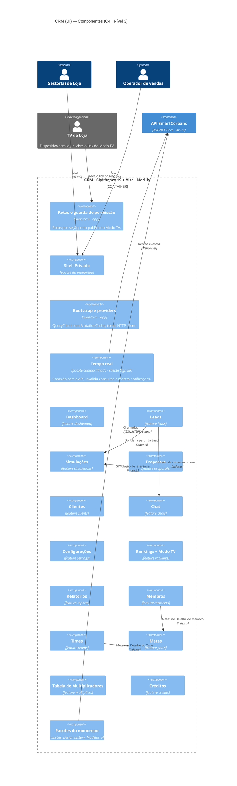

# SmartCorbans — C4 Model · Nível 3: Componentes do CRM (UI)

**Status:** Draft
**Versão:** 0.2
**Base:** C4 · Nível 2 (`02-containers.md` v0.2), CRM — Documento de Produto e documentos de módulo do CRM, `03-componentes-admin.md` (pacotes compartilhados)
**Nível anterior:** 02 — Containers · **Pares:** 03 — Componentes da API, do Admin e do Marketing

## Histórico de revisões

| Versão | Mudanças |
|---|---|
| 0.2 | O cliente de **Tempo real** passa a ter segundo consumidor (Marketing, ADR-0015) e sobe para pacote compartilhado, pela regra do segundo uso. |
| 0.1 | Primeira versão. Abre o container **CRM** em componentes de aplicação (inclui o cliente de tempo real e a rota pública do Modo TV), 14 features agrupadas pelas cinco seções da navegação, e os pacotes compartilhados do monorepo. |

---

## 1. Escopo do diagrama

Este nível abre o container **CRM** (SPA · React 19 + Vite, hospedada na Netlify).

- Os **pacotes do monorepo** são os mesmos do Admin (`03-componentes-admin.md`, §3.3). Aparecem no diagrama, mas não são descritos de novo.
- **Duas diferenças do CRM** em relação ao Admin: a **conexão em tempo real** com a API (Chat e notificações) e o **Modo TV**, uma rota pública aberta por link com token, sem login (RF-RNK-04).
- Fora deste nível: a estrutura interna de cada feature (`presentation/domain/data`).

## 2. Diagrama

## 3. Componentes

### 3.1. Componentes da aplicação (`apps/crm`)

| Componente | Responsabilidade |
|---|---|
| **Bootstrap e providers** | Igual ao Admin: `QueryClient` com `MutationCache` como ponto único de toast de erro, tema, roteador e HTTP client. Abre a conexão de Tempo real depois do login. |
| **Rotas e guarda de permissão** | Rotas das cinco seções, cada uma exigindo uma permissão do catálogo do CRM. Inclui a **rota pública do Modo TV**, fora do Shell e sem login: lê o token do link e chama a API com ele (RF-RNK-04). O usuário cai no Dashboard ao entrar. |
| **Shell Privado** *(pacote)* | O mesmo do Admin. No CRM, mostra as notificações que chegam pelo Tempo real. |
| **Tempo real** | Cliente WebSocket da API *(ADR-0010)*. Ao receber um evento (mensagem nova no Chat, Lead atribuída, Proposta paga), **invalida as consultas do TanStack Query** afetadas e dispara a notificação no Shell. Não guarda estado próprio. Com o Marketing também usando (ADR-0015), sobe para pacote compartilhado, pela regra do segundo uso. |

### 3.2. Features

Organizadas pelas cinco seções da navegação do CRM (CRM, Documento de Produto, §1). Pasta pelo recurso principal do catálogo (P-10).

| Seção | Feature | Pasta | Permissões (recurso) | Módulo de domínio na API |
|---|---|---|---|---|
| Visão geral | **Dashboard** | `dashboard` | `view` do módulo de cada bloco | Desempenho |
| Operação | **Leads** (board kanban, Card e Sheet pelo Layout de Lead) | `leads` | `leads` | Leads e Distribuição |
| Operação | **Simulações** | `simulations` | `simulations` | Motor de Simulação |
| Operação | **Propostas** | `proposals` | `proposals`, `proposals_*` | Propostas |
| Operação | **Clientes** | `clients` | `clients`, `clients_documents` | Clientes |
| Operação | **Chat** (tela dedicada e painel exportado para o card da Lead) | `chats` | `chats` | Atendimento |
| Operação | **Configurações** da Loja | `settings` | `store_profile`, `store_segments` | Estrutura |
| Desempenho | **Rankings**, com o **Modo TV** | `rankings` | `rankings` | Desempenho |
| Desempenho | **Relatórios** | `reports` | `crm_reports_*` | Desempenho |
| Gestão | **Membros** | `members` | `members`, `members_sessions` | Acesso |
| Gestão | **Times** | `teams` | `crm_teams` | Estrutura |
| *(anexada)* | **Metas**: sem rota própria; exporta os blocos usados no Detalhe do Time e do Membro | `goals` | `goals` | Desempenho |
| Financeiro | **Tabela de Multiplicadores** | `multipliers` | `multipliers` | Propostas |
| Financeiro | **Créditos** | `credits` | `credits` | Créditos |

**Pasta com mais de um recurso.** Quando o módulo tem mais de um recurso no catálogo, a pasta leva o nome do módulo em inglês (`settings`). Complementa a convenção de nome de pasta (ex-P-10, registrada na skill do monorepo).

## 4. Dependências entre features

Pelo `index.ts`. Tiradas das seções "Depende de" dos módulos.

| Feature | Usa | Para quê | Origem |
|---|---|---|---|
| Leads | Chat | Painel de conversa no card da Lead | CRM · Chat |
| Leads | Simulações | Simular a partir da Lead | CRM · Simulações |
| Leads | Propostas | A Ação Formalizar abre a Proposta | CRM · Propostas |
| Propostas | Simulações | Simulação de referência e Ofertas em consideração | CRM · Propostas, "Depende de" |
| Propostas | Clientes | Documentos do Cliente | CRM · Propostas, "Depende de" |
| Clientes | Simulações, Chat, Propostas, Leads | Abas da ficha do Cliente | CRM · Clientes, "Depende de" |
| Times, Membros | Metas | Metas no Detalhe | CRM · Metas |
| Dashboard | Leads, Propostas, Metas, Créditos, Simulações | Blocos da tela inicial | CRM · Dashboard, "Depende de" |
| Rankings | Times, Membros | Seleção de Cargos elegíveis e exibição | CRM · Rankings |

Dados que vêm do Admin (Funil, Layout de Lead, Ofertas, Status de Proposta) chegam **pela API**, nunca por import de feature do Admin.

## 5. Regras deste container

As seis regras do Admin (`03-componentes-admin.md`, §5) valem igual. Mais duas:

1. **O Tempo real só invalida consultas.** O dado novo sempre vem da API pelo TanStack Query; o evento é só o aviso de que ele mudou.
2. **O Modo TV não usa sessão de usuário.** A rota pública usa só o token do link e só lê os Rankings marcados para TV.

## 6. Candidatos a pacote pela regra do segundo uso

Pontos em que o CRM precisa de algo que o Admin já tem. Como nenhum app importa feature de outro, cada um vira pacote quando o segundo uso for implementado:

| O quê | Admin | CRM / Marketing | Por quê |
|---|---|---|---|
| **Mecânica de Relatórios** (Visões salvas, filtros, agrupamento, exportação) | `reports` | `reports` (CRM) | Os três relatórios compartilhados têm a mesma mecânica, sem a dimensão Loja no CRM (Admin, §5). |
| **Combobox de Origem de Venda** | `sale-origins` | `leads` (CRM), Prospecção e Carteira Ativa (Marketing) | O cadastro é gerido no ponto de uso, nas três aplicações. |
| **Formulário de Usuário** | `users` | `members` | Membros é o mesmo Usuário com escopo `store` (CRM · Membros). |

## 7. Premissas deste nível

Nenhuma nova. Valem a ADR-0010 (tempo real por WebSocket) e a convenção de nome de pasta (ex-P-10), com o complemento da §3.2.
