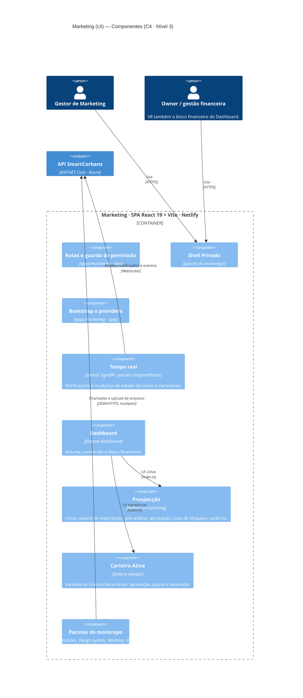

# SmartCorbans — C4 Model · Nível 3: Componentes do Marketing (UI)

**Status:** Draft
**Versão:** 0.2
**Base:** C4 · Nível 2 (`02-containers.md` v0.2), Marketing — Documento de Produto e documentos de módulo, `03-componentes-admin.md` (pacotes compartilhados)
**Nível anterior:** 02 — Containers · **Pares:** 03 — Componentes da API, do Admin e do CRM

## Histórico de revisões

| Versão | Mudanças |
|---|---|
| 0.2 | **Tempo real e notificações no Marketing** (ADR-0015; Marketing v0.9, RN-MKT-10): sai a consulta periódica (P-11 rejeitada). O app ganha o componente Tempo real, como o CRM, e as notificações de exceção chegam ao sino do Shell. |
| 0.1 | Primeira versão. Abre o container **Marketing** em componentes de aplicação, três features e os pacotes compartilhados do monorepo. |

---

## 1. Escopo do diagrama

Este nível abre o container **Marketing** (SPA · React 19 + Vite, hospedada na Netlify).

- Os **pacotes do monorepo** são os mesmos do Admin (`03-componentes-admin.md`, §3.3).
- O Marketing **tem tempo real**, como o CRM (ADR-0015): recebe as **notificações** de exceção (RN-MKT-10) e os avisos de mudança de estado que atualizam a tela aberta da Lista ou da Varredura.
- O processamento pesado (importação, pré-análise em lote, Varreduras, injeção) roda no **Worker** (nível 2). A UI só dispara e acompanha.

## 2. Diagrama

## 3. Componentes

### 3.1. Componentes da aplicação (`apps/marketing`)

Iguais aos do Admin: **Bootstrap e providers**, **Rotas e guarda de permissão** e o **Shell Privado** (pacote). Mais o **Tempo real**, igual ao do CRM (`03-componentes-crm.md`, §3.1): conexão com o hub da API, que invalida consultas e entrega as notificações ao sino (ADR-0015). Pela regra do segundo uso, o cliente de tempo real sobe do CRM para um pacote compartilhado. O Marketing aparece no app switcher para quem tem alguma permissão de Marketing.

### 3.2. Features

Todos os recursos do Marketing têm escopo `all`, porque a aplicação atua acima das Lojas.

| Feature | Pasta | Permissões (recurso) | O que tem dentro | Módulo de domínio na API |
|---|---|---|---|---|
| **Dashboard** | `dashboard` | `view` das fontes · `marketing_finance` (bloco financeiro) | Volume, conversão e retorno financeiro | Desempenho |
| **Prospecção** | `prospecting` | `prospecting_lists`, `blocklist`, `marketing_settings` | Lista de Listas; **wizard de importação** (upload, mapeamento de colunas, dados da Lista, configuração da pré-análise); detalhe com o funil da pré-análise; **aprovação** da injeção; Lista de bloqueio; carência | Marketing |
| **Carteira Ativa** | `sweeps` | `sweeps` | Wizard da Varredura (Segmento, Filtro de base com contagem estimada, Operações); aprovação; pausa, retomada e edição da Recorrente | Marketing |

**Pasta com mais de um recurso:** `prospecting` reúne três recursos, pela regra complementar da convenção de nome de pasta (ex-P-10) (`03-componentes-crm.md`, §3.2).

**Ações de dinheiro separadas.** O botão de aprovar (`approve`) fica separado de criar e editar, porque liberar a injeção debita o saldo das Lojas (Marketing, §2). A UI esconde o botão sem a permissão; a API reaplica.

## 4. Dependências

| Feature | Usa | Para quê |
|---|---|---|
| Dashboard | Prospecção, Carteira Ativa | Rótulos e filtros por Lista e por Varredura |
| Prospecção, Carteira Ativa | Combobox de Origem de Venda | Rótulo da Lista e da Varredura; vem do pacote candidato (`03-componentes-crm.md`, §6) |

Segmentos, Funis, Operações e Ofertas chegam **pela API**, nunca por import de feature do Admin.

## 5. Regras deste container

As seis regras do Admin (`03-componentes-admin.md`, §5) valem igual. Mais uma:

1. **O Tempo real só invalida consultas** (mesma regra do CRM). Quando uma Lista ou Varredura muda de estado, a tela aberta recarrega da API; não há consulta periódica (ADR-0015).

## 6. Decisões deste nível

- **P-11 rejeitada** em favor da [ADR-0015](../ADR/ADR-0015-tempo-real-no-marketing.md): tempo real também no Marketing, para notificações e andamento.
