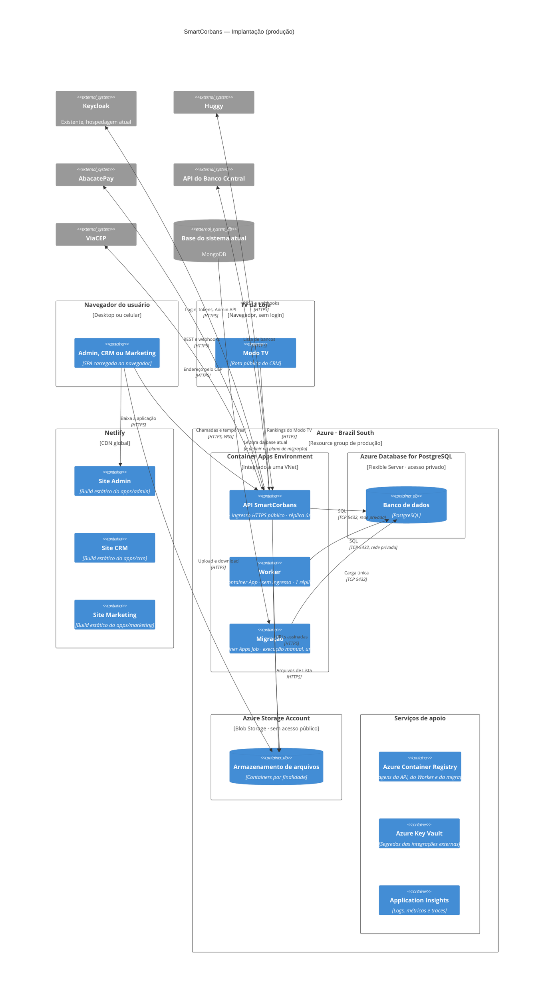

# SmartCorbans — C4 Model · Diagrama de implantação

**Status:** Draft
**Versão:** 0.5
**Base:** C4 · Nível 2 (`02-containers.md` v0.2), decisões D-09 a D-11, Componentes da API (`03-componentes-api.md` v0.4)
**Tipo:** diagrama suplementar do C4 (deployment)

## Histórico de revisões

| Versão | Mudanças |
|---|---|
| 0.5 | Inclui o **Azure Blob Storage** privado para arquivos (ADR-0024). |
| 0.4 | Inclui o **ViaCEP** entre as saídas para externos. |
| 0.3 | **Premissas fechadas em ADR** (ADR-0016 a ADR-0022). Banco acessado **sem senha** por Managed Identity (ADR-0019); NAT Gateway só quando algum externo exigir (ADR-0020); homologação descrita em código (ADR-0022). Base do sistema atual identificada como MongoDB (ADR-0003). |
| 0.2 | API passa a **réplica única**, sem escalonamento automático nem afinidade de sessão (ADR-0009, ADR-0010). |
| 0.1 | Primeira versão. Mapeia os containers do nível 2 para a Netlify (três sites) e para a Azure (Container Apps, PostgreSQL Flexible Server e serviços de apoio). Os serviços específicos da Azure são **premissas** (§6). |

---

## 1. Escopo

Mostra **onde cada container roda** em produção e por onde o tráfego passa. Parte das decisões já tomadas:

- **D-10:** o banco é PostgreSQL.
- **D-11:** o backend (API, Worker e banco) fica na **Azure**, e as três aplicações web na **Netlify**.
- **D-07:** o Keycloak é o **existente**, e continua onde está hoje. O diagrama o mostra fora da Azure do SmartCorbans.

Homologação tem a mesma forma de produção, com recursos menores *(ADR-0022)*. O diagrama mostra produção.

## 2. Diagrama

A versão desenhada está publicada como página.

## 3. Nós e o que roda em cada um

| Nó | Serviço | O que roda | Container (nível 2) |
|---|---|---|---|
| **Netlify** | Três sites, um por app, cada um com o seu domínio *(ADR-0016)* | Build estático do Vite. Regra de SPA (`/* /index.html 200`) para as rotas do cliente. Build pelo monorepo, filtrado por app no Turborepo. | Admin, CRM, Marketing |
| **Container Apps Environment** | Azure Container Apps *(ADR-0017)*, integrado a uma VNet | **API**: ingresso HTTPS público, WebSocket habilitado, réplica única (ADR-0009). **Worker**: sem ingresso, uma réplica. **Migração**: Container Apps Job executado à mão (D-06, D-08). | API SmartCorbans, Worker |
| **Azure Database for PostgreSQL** | Flexible Server *(ADR-0018)*, acesso privado pela VNet, backup automático | O banco único, com um schema por módulo (Componentes da API, §5). | Banco de dados |
| **Azure Storage Account** | Blob Storage *(ADR-0024)*, sem acesso público | Arquivos: logo da Loja, Documentos do Cliente e da Proposta, arquivos de Lista. Acesso da API e do Worker por Managed Identity. | Armazenamento de arquivos |
| **Azure Container Registry** | ACR | Imagens da API, do Worker e da migração. | — |
| **Azure Key Vault** | Key Vault *(ADR-0019)* | Segredos: cliente admin do Keycloak, chaves do AbacatePay e da Huggy, segredos de webhook. Lidos pelos apps por **Managed Identity**. O banco não tem senha: a mesma identidade autentica no PostgreSQL (Microsoft Entra), sem segredo em variável de ambiente. | — |
| **Application Insights** | Application Insights + Log Analytics | Logs, métricas e traces da API e do Worker. O Log Analytics também é exigido pelo Container Apps Environment. | — |

## 4. Rede e segurança

| Tema | Como fica |
|---|---|
| **Entrada pública** | Só a **API** tem ingresso público (HTTPS e WSS), num domínio próprio. O Worker, a migração e o banco não são expostos. |
| **CORS** | A API libera só os três domínios da Netlify (D-11). |
| **Webhooks** | Huggy e AbacatePay chamam a API pela mesma entrada pública, em rotas próprias; o componente Webhooks valida a origem e a idempotência (Componentes da API, §3.1). |
| **Banco** | Acesso privado pela VNet. Nenhum IP público. |
| **Saída para externos** | Keycloak, Huggy, AbacatePay, Banco Central e ViaCEP por HTTPS. Se algum deles exigir lista de IPs liberados, a VNet ganha um NAT Gateway com IP de saída fixo *(ADR-0020)*. |
| **Arquivos** | Blob Storage sem acesso público; navegador envia e baixa por URL assinada de curta duração, gerada pela API; CORS só para os três domínios da Netlify *(ADR-0024)*. |
| **Segredos** | Só no Key Vault, lidos por Managed Identity. Banco acessado sem senha (ADR-0019). |
| **Dados no Brasil** | Região **Brazil South** *(ADR-0021)*, pelos dados pessoais e financeiros tratados (RNF003). |

## 5. Escala e disponibilidade

| Container | Regra | Por quê |
|---|---|---|
| **API** | **Uma réplica fixa**, escalonamento automático desligado ([ADR-0009](../ADR/ADR-0009-api-replica-unica.md)) | Volume de instância única; deploy por revisão sem indisponibilidade; o tempo real dispensa backplane (ADR-0010). **Não aumentar réplicas sem substituir a ADR-0009.** |
| **Worker** | **Uma réplica** no início | Evita rodar duas vezes a mesma Varredura agendada. A fila no PostgreSQL usa trava por linha, então mais réplicas podem entrar depois sem duplicar trabalho. |
| **Banco** | Backup automático do Flexible Server; alta disponibilidade por zona como opção | A decisão de HA depende do custo; não muda o diagrama. |
| **Sites** | CDN da Netlify | Estáticos, sem estado. |

## 6. Decisões deste diagrama

| ADR | Decisão |
|---|---|
| [ADR-0016](../ADR/ADR-0016-tres-sites-netlify.md) | Três sites na Netlify, um por app, em subdomínios do mesmo domínio-pai da API. |
| [ADR-0017](../ADR/ADR-0017-azure-container-apps.md) | API, Worker e migração no Azure Container Apps, num ambiente integrado à VNet. |
| [ADR-0018](../ADR/ADR-0018-postgresql-flexible-server-privado.md) | PostgreSQL Flexible Server com acesso privado; HA por zona desligada no início. |
| [ADR-0019](../ADR/ADR-0019-key-vault-managed-identity.md) | Segredos no Key Vault, lidos por Managed Identity; banco sem senha. |
| [ADR-0020](../ADR/ADR-0020-nat-gateway-sob-demanda.md) | NAT Gateway só quando algum externo exigir IP fixo. |
| [ADR-0021](../ADR/ADR-0021-regiao-brazil-south.md) | Região Brazil South, a mesma do sistema atual. |
| [ADR-0022](../ADR/ADR-0022-homologacao-mesma-forma.md) | Homologação com a mesma forma de produção, descrita em código. |
| [ADR-0009](../ADR/ADR-0009-api-replica-unica.md) | API com réplica única. |
| [ADR-0024](../ADR/ADR-0024-armazenamento-de-arquivos-blob.md) | Arquivos no Blob Storage privado, entregues por URL assinada. |

## 7. Fora deste diagrama

- **Pipeline de CI/CD** (build das imagens, publicação no ACR, deploy dos sites). Não muda a topologia. A infraestrutura em si é descrita em código (ADR-0022).
- **Domínio e DNS.** O diagrama usa `api.<domínio>` e um subdomínio por app; os nomes reais entram quando o domínio for definido.
- **Hospedagem do Keycloak.** Continua a atual (D-07). Se ele estiver na mesma Azure, a chamada da API pode passar a ser privada.
