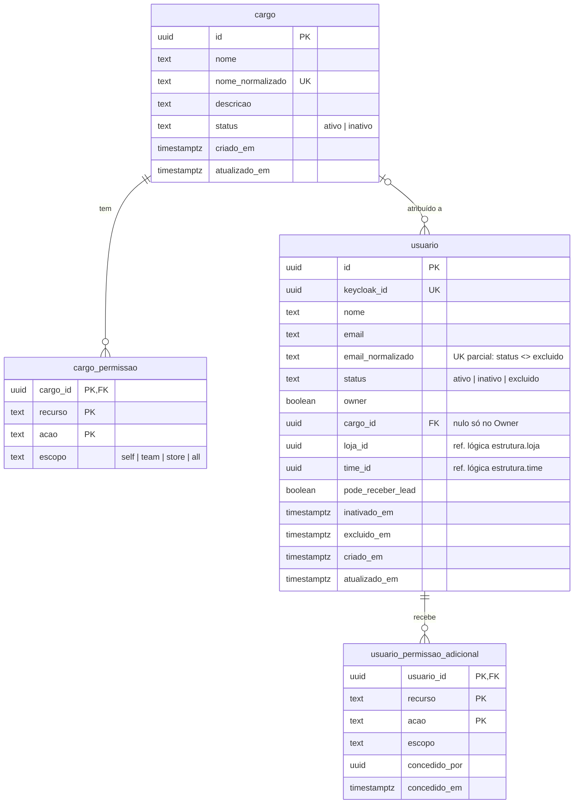

# SmartCorbans — Modelo de dados · Acesso

**Status:** Suspenso — Acesso fica fora do modelo de dados (Keycloak), Modelo de dados v0.2. Mantido só como registro.
**Versão:** 0.1
**Data:** 10/10/2026
**Schema:** `acesso`
**Base:** Admin · Cargos v0.4, Admin · Usuários v0.7, CRM · Membros v0.5, spec §5 e RNF005, ADR-0001, ADR-0002

## Histórico de revisões

| Versão | Mudanças |
|---|---|
| 0.1 | Primeira versão. |

## 1. O que o módulo guarda

Usuários, Cargos e permissões. **Credenciais e sessões ficam no Keycloak** (ADR-0001, ADR-0002): o SmartCorbans não guarda senha nem sessão. Listar e revogar sessões (RF-USR-02) e definir a senha inicial (RF-USR-03) são chamadas ao Keycloak pelo adaptador. Membro do CRM é o mesmo Usuário (CRM · Membros).

O **catálogo de permissões** (recursos, ações e escopos oferecíveis) **vive no código**, no projeto `Acesso.Contracts`, e não em tabela: é contrato entre API e front (`@corban/permissions`) e só muda com nova versão do produto. As tabelas guardam as linhas concedidas, validadas contra esse catálogo na escrita.

## 2. Diagrama

## 3. Tabelas

### 3.1. `cargo`

| Coluna | Tipo | Nulo | Regra |
|---|---|---|---|
| `id` | uuid | não | PK, UUID v7. |
| `nome` | text | não | — |
| `nome_normalizado` | text gerada | não | `lower(trim(nome))`, **único** (RN-CRG-05). |
| `descricao` | text | sim | — |
| `status` | text | não | `ativo` \| `inativo`, padrão `ativo`. Inativo não recebe novas atribuições (RN-CRG-01). |
| `criado_em`, `atualizado_em` | timestamptz | não | — |

"Em uso" não é coluna: é a contagem de `usuario` com o `cargo_id` (Cargos §6). Exclusão de Cargo é **física**, permitida só sem usuário vinculado (RN-CRG-01); a trilha fica na Auditoria (RN-CRG-03).

### 3.2. `cargo_permissao`

| Coluna | Tipo | Nulo | Regra |
|---|---|---|---|
| `cargo_id` | uuid | não | PK, FK → `cargo` (cascade ao excluir o Cargo). |
| `recurso` | text | não | PK. Do catálogo, plural (`leads`, `roles`…). |
| `acao` | text | não | PK. Do catálogo (`view`, `manage_permissions`…). |
| `escopo` | text | não | `self` \| `team` \| `store` \| `all`, só os que o catálogo oferece para o par. |

Um par `recurso:ação` aparece **uma vez** por Cargo: os escopos são cumulativos (`all ⊇ store ⊇ team ⊇ self`), então guardar dois escopos do mesmo par não acrescenta nada.

### 3.3. `usuario`

| Coluna | Tipo | Nulo | Regra |
|---|---|---|---|
| `id` | uuid | não | PK, UUID v7. |
| `keycloak_id` | uuid | não | **Único.** Id do usuário no realm (ADR-0001). |
| `nome` | text | não | — |
| `email` | text | não | Identificador de login. |
| `email_normalizado` | text gerada | não | `lower(trim(email))`. **Único entre não excluídos** (índice parcial `WHERE status <> 'excluido'`): o e-mail do excluído fica liberado (RN-USR-04, RN-USR-05). |
| `status` | text | não | `ativo` \| `inativo` \| `excluido` (Usuários §7). |
| `owner` | boolean | não | Padrão `false`. **Um só** `true` (índice único parcial `WHERE owner`). Owner tem bypass total, não tem Cargo e não é editável nem excluível (RN-USR-03). |
| `cargo_id` | uuid | sim | FK → `cargo`. `CHECK (owner OR cargo_id IS NOT NULL)`: obrigatório para todos menos o Owner (RN-USR-01). |
| `loja_id` | uuid | sim | Ref. lógica → `estrutura.loja` (RN-USR-15). |
| `time_id` | uuid | sim | Ref. lógica → `estrutura.time` (RN-USR-02). `CHECK (time_id IS NULL OR loja_id IS NOT NULL)`; que o Time é da mesma Loja, a aplicação valida pelo contrato de Estrutura. |
| `pode_receber_lead` | boolean | não | Padrão `false`. Só tem efeito com Time (RN-USR-14). |
| `inativado_em` | timestamptz | sim | Preenchido ao inativar, limpo ao reativar. |
| `excluido_em` | timestamptz | sim | Preenchido na exclusão em cascata da Loja (RN-LOJ-08). |
| `criado_em`, `atualizado_em` | timestamptz | não | — |

Índices: `loja_id`, `time_id`, `cargo_id`. A reativação restaura Cargo, Time e permissões adicionais porque nada disso é apagado na inativação (RN-USR-12); se a Loja ou o Time não existem mais, a aplicação limpa `loja_id`/`time_id` ao reativar.

### 3.4. `usuario_permissao_adicional`

| Coluna | Tipo | Nulo | Regra |
|---|---|---|---|
| `usuario_id` | uuid | não | PK, FK → `usuario`. |
| `recurso`, `acao` | text | não | PK. Mesmo catálogo do Cargo. |
| `escopo` | text | não | Idem. |
| `concedido_por` | uuid | não | FK → `usuario`. |
| `concedido_em` | timestamptz | não | — |

Só soma (RN-USR-13). A permissão efetiva de um par é o **maior escopo** entre o Cargo e a adicional.

## 4. Permissões efetivas

Não são gravadas: são calculadas por requisição (Cargo ∪ adicionais) e guardadas em cache de memória na API, invalidado quando o Cargo, as linhas dele ou as adicionais do usuário mudam (RN-CRG-02, efeito imediato). Com réplica única (ADR-0009), o cache em memória basta.

## 5. Fora deste schema

| O quê | Onde | Por quê |
|---|---|---|
| Senha, sessões, login | Keycloak | ADR-0001, ADR-0002. |
| Participação na Organização da Loja | Keycloak | Mantida pelo módulo Acesso via adaptador sempre que `loja_id` muda (ADR-0001). |
| Trilha de auditoria do grupo Acesso | `auditoria` | RNF005, RN-USR-17, RN-CRG-03. |
| Loja e Time | `estrutura` | Módulo Estrutura. |

## 6. Migração (MongoDB)

Os usuários já existem no Keycloak (ADR-0001): a carga cria `usuario` com o `keycloak_id` de cada um, depois de consolidados os realms. O detalhe fica no plano de migração.

## 7. Decisões deste modelo

1. Sessões e senha **não** ficam no banco: a fonte é o Keycloak.
2. Catálogo de permissões no **código**, não em tabela.
3. Owner é uma **flag** no usuário, sem Cargo, com unicidade garantida no banco.
4. "Pode receber lead" é **coluna booleana**. A nota de Usuários (RN-USR-14) sobre o backend atual guardar duas listas descreve o sistema de hoje; a migração converte.
5. Uma linha por `recurso:ação` em cada Cargo e em cada usuário.
