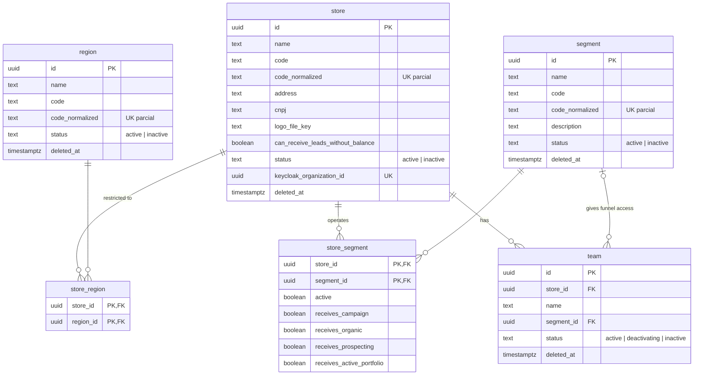

# SmartCorbans — Modelo de dados · Estrutura

**Status:** Validado
**Versão:** 0.1
**Data:** 10/10/2026
**Schema:** `structure`
**Base:** Admin · Lojas v0.15, Regiões v0.7, Segmentos v0.8; CRM · Times, Configurações; Relacionamentos do Admin v0.4; ADR-0001, ADR-0023

## Histórico de revisões

| Versão | Mudanças |
|---|---|
| 0.1 | Primeira versão. |

## 1. O que o módulo guarda

Lojas, Times, Regiões, Segmentos e as associações da Loja com Regiões e Segmentos. Saldo e Extrato são do módulo Créditos; o Funil que nasce com o Segmento é do módulo Funis. **Quem pertence a qual Loja e Time fica no Keycloak** (Acesso fora do modelo): a Loja é uma Organização (ADR-0001), e este schema guarda o id dela.

## 2. Diagrama

Todas as tabelas têm `created_at` e `updated_at` (omitidos no diagrama).

## 3. Tabelas

### 3.1. `store` (Loja)

| Coluna | Tipo | Nulo | Regra |
|---|---|---|---|
| `id` | uuid | não | PK. |
| `name` | text | não | — |
| `code` | text | não | Editável. |
| `code_normalized` | text gerada | não | **Único entre não excluídas** (`WHERE deleted_at IS NULL`): excluir libera o Código (RN-LOJ-15). |
| `address` | text | não | Texto livre; a spec não estrutura o endereço da Loja. |
| `cnpj` | text | sim | Opcional na v1. |
| `logo_file_key` | text | sim | Chave do arquivo no armazenamento de arquivos (ver §6, item 1). |
| `can_receive_leads_without_balance` | boolean | não | Padrão `false`. Permite saldo negativo (RN-LOJ-12) e trava as Origens ligadas (RN-LOJ-18). Editada só com `stores:manage_credits:all`. |
| `status` | text | não | `active` \| `inactive`. Inativa não recebe itens novos (RN-LOJ-06). |
| `keycloak_organization_id` | uuid | não | **Único.** A Organização da Loja no Keycloak (ADR-0001), criada junto com a Loja pelo adaptador. |
| `deleted_at` | timestamptz | sim | Exclusão suave (RN-LOJ-15). Bloqueada com itens ativos em algum Time (RN-LOJ-07), regra checada pela aplicação no contrato de Leads. |

**Sem linha em `store_region` = "Todas"** (RN-LOJ-14, RN-REG-04): a ausência de restrição não é gravada como valor.

### 3.2. `team` (Time)

| Coluna | Tipo | Nulo | Regra |
|---|---|---|---|
| `id` | uuid | não | PK. |
| `store_id` | uuid | não | FK → `store`. **Imutável** (RN-LOJ-10), garantido pela aplicação. |
| `name` | text | não | — |
| `segment_id` | uuid | sim | FK → `segment`. Só um Segmento que a Loja tem `active` com ao menos uma Origem ligada (RN-LOJ-02); validado pela aplicação. Sem Segmento, sem Funil. |
| `status` | text | não | `active` \| `deactivating` \| `inactive` (Lojas §6). `deactivating` é a drenagem (RN-LOJ-03); o Worker passa a `inactive` quando o último item termina. |
| `deleted_at` | timestamptz | sim | Exclusão suave (RN-LOJ-05); em cascata quando a Loja é excluída (RN-LOJ-09). |

### 3.3. `region` (Região)

| Coluna | Tipo | Nulo | Regra |
|---|---|---|---|
| `id` | uuid | não | PK. |
| `name` | text | não | — |
| `code`, `code_normalized` | text | não | Código único entre não excluídas. |
| `status` | text | não | `active` \| `inactive`. |
| `deleted_at` | timestamptz | sim | Exclusão (RN-REG-03). |

Inativar ou excluir **apaga as linhas** de `store_region` dessa Região e pede ao Catálogo que apague as de `catalog.promoter_region`, na mesma transação (RN-REG-02, ADR-0012). Reativar não as devolve.

### 3.4. `segment` (Segmento)

| Coluna | Tipo | Nulo | Regra |
|---|---|---|---|
| `id` | uuid | não | PK. |
| `name` | text | não | — |
| `code`, `code_normalized` | text | não | Código único entre não excluídos. |
| `description` | text | sim | — |
| `status` | text | não | `active` \| `inactive`. Inativar cascateia para o Funil, se ativo (RN-SEG-06), pelo contrato de Funis. |
| `deleted_at` | timestamptz | sim | Bloqueado se o Funil já foi ativado ou se há Oferta (RN-SEG-04, RN-SEG-08), checado nos contratos de Funis e Catálogo. Excluir apaga as linhas de `store_segment` e limpa `team.segment_id` (RN-SEG-09). |

Criar o Segmento cria o Funil na mesma transação, pelo contrato de Funis (RN-SEG-05).

### 3.5. `store_region`

Chave `(store_id, region_id)`, FKs para `store` e `region`. Associar a primeira Região pede confirmação; remover a última volta a "Todas" (RN-LOJ-14).

### 3.6. `store_segment` (Loja × Segmento)

| Coluna | Tipo | Nulo | Regra |
|---|---|---|---|
| `store_id`, `segment_id` | uuid | não | PK, FKs. |
| `active` | boolean | não | A Loja opera o Segmento. Desligar é bloqueado com Leads em andamento (RN-LOJ-16), checado no contrato de Leads. |
| `receives_campaign`, `receives_organic`, `receives_prospecting`, `receives_active_portfolio` | boolean | não | Um por Origem com preço (RN-LOJ-17). `CHECK (active OR NOT (receives_campaign OR receives_organic OR receives_prospecting OR receives_active_portfolio))`: Origem exige `active` (RN-LOJ-01). Ao ligar `active`, nascem `true`. |

Uma linha por par que já foi ativado alguma vez; desligar `active` mantém a linha. Editada pelo Admin e pelo CRM (Configurações, RN-CFG-01), no mesmo registro.

## 4. Fora deste schema

| O quê | Onde |
|---|---|
| Usuário na Loja e no Time, "Pode receber lead" | Keycloak (Acesso fora do modelo) |
| Saldo, Extrato, limite de gasto diário | `credits` |
| Funil do Segmento | `funnels` |
| Região da Promotora | `catalog` |
| Link do Modo TV da Loja | `performance` |

## 5. Decisões deste modelo

1. **Origens da Loja como quatro colunas booleanas**, e não uma tabela: são quatro valores fixos do produto (RN-FNL-07), e o `CHECK` garante a regra de "Ativo" no próprio banco.
2. **"Todas" as Regiões = nenhuma linha.**
3. **Endereço da Loja como texto livre**, porque a spec não o estrutura (o do Cliente, sim, por causa do ViaCEP).

## 6. Pontos para outros documentos

1. **Arquivos:** decidido na **ADR-0024** (Blob Storage privado, URL assinada). `logo_file_key` é a chave do arquivo no container `store-logos`.
2. **Acesso no Keycloak:** levar Cargo, permissões, Time do usuário, "Pode receber lead", permissões adicionais e Owner para o Keycloak estende a ADR-0001 e muda o componente Acesso do C4. **Fica para debate depois da modelagem** (decisão do usuário); sem ADR por enquanto.
