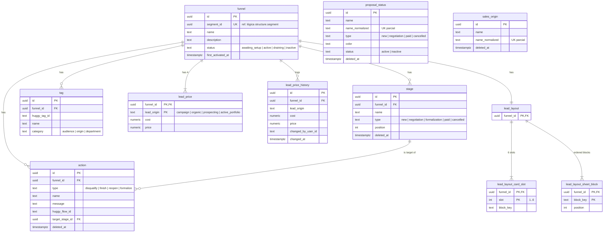

# SmartCorbans — Modelo de dados · Funis

**Status:** Validado
**Versão:** 0.2
**Data:** 10/10/2026
**Schema:** `funnels`
**Base:** Admin · Funis de Vendas v0.17, Layout de Lead v0.7, Status de Proposta v0.7, Origem de Venda v0.8; Relacionamentos do Admin v0.4; ADR-0023

## Histórico de revisões

| Versão | Mudanças |
|---|---|
| 0.2 | Origem de Venda: quem a usa guarda **só o id**; o rótulo sobrevive à exclusão porque ela é suave (decisão do usuário). |
| 0.1 | Primeira versão. |

## 1. O que o módulo guarda

O Funil de cada Segmento com Stages, Ações, Tags, preço por Origem da lead e o histórico de preço; o Layout de Lead do Funil; os cadastros de Status de Proposta e de Origem de Venda. Lead e Proposta ficam em `leads` e `proposals`, que referenciam Stage, Status e Origem de Venda por id.

## 2. Diagrama

`proposal_status` e `sales_origin` são cadastros soltos, sem relação com o Funil. Todas as tabelas de cadastro têm `created_at` e `updated_at` (omitidos no diagrama).

## 3. Tabelas

### 3.1. `funnel`

| Coluna | Tipo | Nulo | Regra |
|---|---|---|---|
| `id` | uuid | não | PK. |
| `segment_id` | uuid | não | Ref. lógica → `structure.segment`. **Único** (um Funil por Segmento, RN-FNL-01) e **imutável** (RN-FNL-12). |
| `name` | text | não | Sugerido a partir do Segmento na criação. |
| `description` | text | sim | — |
| `status` | text | não | `awaiting_setup` \| `active` \| `draining` \| `inactive` (Funis §6). `draining` = inativo com Leads em curso, ainda visível às Lojas; `inactive` = drenado. A passagem de `draining` a `inactive` acontece quando Leads avisa que a última Lead em curso do Funil terminou (RN-FNL-14). |
| `first_activated_at` | timestamptz | sim | Preenchido na primeira ativação, nunca limpo. É o que bloqueia a exclusão do Segmento (RN-SEG-04, RN-FNL-09). |

Sem `deleted_at`: o Funil nunca ativado é apagado de verdade, em cascata com o Segmento (RN-FNL-09); o ativado nunca é excluído.

### 3.2. `stage`

| Coluna | Tipo | Nulo | Regra |
|---|---|---|---|
| `id` | uuid | não | PK. |
| `funnel_id` | uuid | não | FK → `funnel`. |
| `name` | text | não | Nos Stages `cancelled`, é também o Motivo (RN-FNL-18). |
| `type` | text | não | StageType (RN-FNL-13). |
| `position` | int | não | Ordem da coluna no board. |
| `deleted_at` | timestamptz | sim | Remoção suave: Leads e o histórico delas continuam apontando para o Stage. |

Índice único parcial `(funnel_id, type) WHERE type IN ('new','formalization','paid') AND deleted_at IS NULL`: **um só** Stage de Novo, Formalização e Pago (RN-FNL-15). A cobertura dos cinco tipos e o bloqueio de remover o único de um tipo são validados pela aplicação.

### 3.3. `action`

| Coluna | Tipo | Nulo | Regra |
|---|---|---|---|
| `id` | uuid | não | PK. |
| `funnel_id` | uuid | não | FK → `funnel`. |
| `type` | text | não | Os quatro tipos configuráveis. **Mover lead não tem linha**: é calculada pelo board (Funis §3.3). |
| `name` | text | não | — |
| `message` | text | sim | Enviada ao cliente ao executar. |
| `huggy_flow_id` | text | sim | Fluxo da Huggy, efeito colateral não bloqueante (RN-FNL-04). |
| `target_stage_id` | uuid | não | FK → `stage`. O tipo do Stage tem de bater com o da Ação (RN-FNL-19); nunca `paid` (RN-FNL-20). Validado pela aplicação. |
| `deleted_at` | timestamptz | sim | O histórico da Lead guarda o nome da Ação executada como texto. |

### 3.4. `tag`

| Coluna | Tipo | Nulo | Regra |
|---|---|---|---|
| `id` | uuid | não | PK. |
| `funnel_id` | uuid | não | FK → `funnel`. |
| `huggy_tag_id` | text | não | Id na Huggy. Único por Funil. |
| `name` | text | não | — |
| `category` | text | não | Categoria fixa (RN-FNL-05). |

### 3.5. `lead_price` e `lead_price_history`

`lead_price`: chave `(funnel_id, lead_origin)`, **quatro linhas criadas com o Funil**, com `cost` e `price` em `numeric(14,2)`, ambos `0` (RN-FNL-07). Sem `CHECK` de margem: preço abaixo do custo é permitido (RN-FNL-08).

`lead_price_history`: **append-only** (RN-FNL-16). Uma linha a cada mudança de custo ou preço de uma Origem; os zeros iniciais não geram linha. Quem alterou fica em `changed_by_user_id` (id do Keycloak). A alteração de preço também vai para a Auditoria (RNF005, grupo Dinheiro).

O **débito** em Créditos guarda o preço cobrado, então mudar o preço depois não altera o que já foi cobrado.

### 3.6. Layout de Lead

| Tabela | Chave | Regra |
|---|---|---|
| `lead_layout` | `funnel_id` | Um por Funil (RN-LAY-02), criado com ele. |
| `lead_layout_card_slot` | `(funnel_id, slot)` | Seis slots, um bloco cada (RN-LAY-01). No slot 3, `block_key` é uma das três variantes; padrão `beneficiary_info` (RN-LAY-12, RN-LAY-03). |
| `lead_layout_sheet_block` | `(funnel_id, block_key)` | Blocos do Sheet em ordem (`position`). Os oito obrigatórios não podem sair (RN-LAY-05), validado pela aplicação. |

O **catálogo de blocos é fechado** (Layout §3.4): as chaves (`block_key`) vivem no código, compartilhadas com o front, e não em tabela.

### 3.7. `proposal_status` (Status de Proposta)

| Coluna | Tipo | Nulo | Regra |
|---|---|---|---|
| `id` | uuid | não | PK. |
| `name`, `name_normalized` | text | não | Único entre não excluídos (RN-STP-09). |
| `type` | text | não | StatusType (Status §3). Não compartilha enum com o Stage. |
| `color` | text | não | Hex da cor de fundo; a do texto é derivada na interface (RN-STP-06). |
| `status` | text | não | `active` \| `inactive`. |
| `deleted_at` | timestamptz | sim | Exclusão suave (RN-STP-03), depois da migração das Propostas (RN-STP-02). |

A Proposta nasce no ativo mais antigo do tipo `new` (RN-STP-08): ordem por `created_at`. O último ativo de cada tipo não sai (RN-STP-07) e o tenant nasce com um de cada tipo (RN-STP-10): regras da aplicação e da carga inicial.

### 3.8. `sales_origin` (Origem de Venda)

Só `id`, `name`, `name_normalized` (único entre não excluídas, RN-ORI-03) e `deleted_at`. Quem a usa (Lead, Proposta, Lista, Varredura) guarda **só o `sales_origin_id`**. Como a exclusão é suave, o nome continua legível depois de excluída: some das seleções e segue exibido nos registros que já a usam (RN-ORI-04, RN-ORI-07).

## 4. Fora deste schema

| O quê | Onde |
|---|---|
| Lead, Stage atual da Lead, histórico de Ações | `leads` |
| Proposta e Status atual | `proposals` |
| Segmento | `structure` |
| Débito com o preço cobrado | `credits` |

## 5. Decisões deste modelo

1. **`draining` e `inactive` como estados gravados**, trocados por evento de Leads, em vez de calculados a cada leitura (o board e as Lojas consultam o tempo todo).
2. **Stage e Ação com exclusão suave**, porque Leads e o histórico delas apontam para eles.
3. **Unicidade de Novo, Formalização e Pago no banco**, por índice parcial.
4. **Preço em tabela de quatro linhas fixas** por Funil, e não colunas: o histórico é por linha, e o débito referencia a Origem.
5. **Catálogo de blocos do Layout no código.**
6. **Origem de Venda por id**, com exclusão suave preservando o rótulo.
