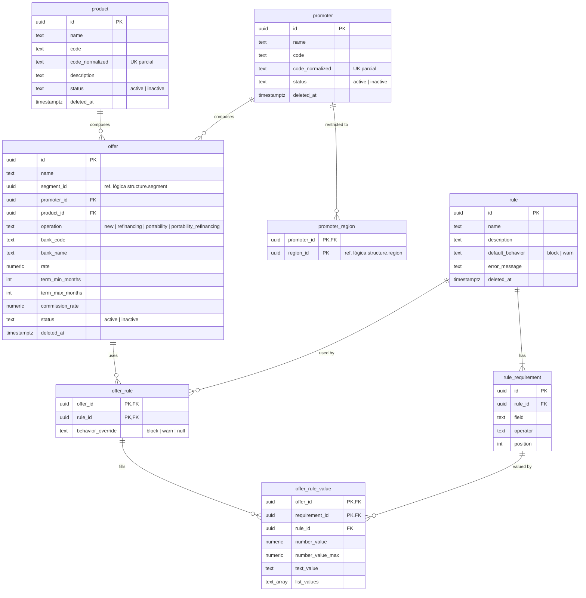

# SmartCorbans — Modelo de dados · Catálogo comercial

**Status:** Validado
**Versão:** 0.1
**Data:** 11/10/2026
**Schema:** `catalog`
**Base:** Admin · Produtos v0.5, Promotoras v0.4, Ofertas v0.15, Regras v0.9; Relacionamentos do Admin v0.4; ADR-0023

## Histórico de revisões

| Versão | Mudanças |
|---|---|
| 0.1 | Primeira versão. |

## 1. O que o módulo guarda

Produtos, Promotoras (com as Regiões), Ofertas, Regras com seus Requisitos e a associação Oferta × Regra com os valores de cada Requisito. É o que o Motor de Simulação lê. O Multiplicador da Loja por Oferta fica em `proposals` (Tabela de Multiplicadores).

## 2. Diagrama

Todas as tabelas de cadastro têm `created_at` e `updated_at` (omitidos no diagrama).

## 3. Tabelas

### 3.1. `product` e `promoter`

Mesma forma: `name`, `code` com `code_normalized` único entre não excluídos, `status` (`active` \| `inactive`) e `deleted_at`. Produto tem `description`. **Oferta não excluída bloqueia** inativar e excluir os dois (RN-PRD-02, RN-PRD-03, RN-PRM-03, RN-PRM-04), checado pela aplicação; o banco reforça com a FK de `offer`.

### 3.2. `promoter_region`

Chave `(promoter_id, region_id)`. `region_id` é ref. lógica → `structure.region`. **Sem linha = Promotora global** (RN-PRM-02). Quando uma Região é inativada ou excluída, Estrutura pede ao Catálogo que apague as linhas dela, na mesma transação (RN-REG-02).

### 3.3. `offer` (Oferta)

| Coluna | Tipo | Nulo | Regra |
|---|---|---|---|
| `id` | uuid | não | PK. |
| `name` | text | não | Sem código (Ofertas §3.2). |
| `segment_id` | uuid | não | Ref. lógica → `structure.segment`. Primeiro filtro do motor (RN-OFR-08); só Segmento ativo em Oferta nova. |
| `promoter_id` | uuid | não | FK → `promoter`. Dá a Região da Oferta (RN-OFR-02). |
| `product_id` | uuid | não | FK → `product`. |
| `operation` | text | não | Catálogo fixo de quatro valores (Ofertas §3.1). Define o valor base da comissão (RN-OFR-07). |
| `bank_code` | text | não | Código do banco (COMPE) na lista do Banco Central. |
| `bank_name` | text | não | Nome no momento do cadastro, para exibir sem depender da API. |
| `rate` | numeric(7,4) | não | Taxa (uma por Oferta). |
| `term_min_months`, `term_max_months` | int | não | Prazo. `CHECK (term_min_months <= term_max_months)`. |
| `commission_rate` | numeric(7,4) | não | Percentual sobre o valor base (RN-OFR-07). |
| `status` | text | não | `active` \| `inactive`. Ativar exige todas as associações completas (RN-OFR-03). |
| `deleted_at` | timestamptz | sim | Exclusão sem bloqueio (RN-OFR-05). Simulações e Propostas guardam o snapshot. |

Sem unicidade da combinação Promotora + Produto + Operação + Banco (RN-OFR-01).

### 3.4. `rule` e `rule_requirement`

`rule`: `name`, `description`, `default_behavior` (`block` \| `warn`), `error_message` (uma por Regra, sem valores, RN-RGR-11) e `deleted_at`. **Sem status**: não há inativação (RN-RGR-09). Excluir apaga as linhas de `offer_rule` da Regra, com alerta antes (RN-RGR-07).

`rule_requirement`: `rule_id` FK, `field`, `operator`, `position`. Ao menos um por Regra (RN-RGR-06), validado pela aplicação. **Campo e operador vêm de catálogos fixos do produto**, definidos no código (Regras §3.3 e §3.4), com o tipo de cada campo e os operadores compatíveis (RN-RGR-02). Editar Campo ou Operador de um requisito é bloqueado com Oferta ativa associada (RN-RGR-13) e apaga os valores dele nas Ofertas inativas (RN-OFR-04).

### 3.5. `offer_rule` e `offer_rule_value`

`offer_rule`: chave `(offer_id, rule_id)`, com `behavior_override` nulo quando vale o padrão da Regra (RN-RGR-05).

`offer_rule_value`: um valor por requisito, por Oferta (RN-RGR-12). Chave `(offer_id, requirement_id)`. Guarda também `rule_id`, para duas FKs compostas: `(offer_id, rule_id)` → `offer_rule` (a Regra está associada) e `(requirement_id, rule_id)` → `rule_requirement` (o requisito é dessa Regra). Desassociar a Regra apaga os valores em cascata. A coluna usada depende do operador (RN-RGR-04):

| Operador | Colunas |
|---|---|
| Maior, menor, igual, diferente (numérico) | `number_value` |
| Intervalo | `number_value` (mínimo) e `number_value_max` |
| Igual, diferente (texto) | `text_value` |
| Deve conter, Não deve conter | `list_values` (ex.: códigos de banco, RN-RGR-03) |

A associação está **completa** quando todo requisito da Regra tem linha aqui (RN-OFR-03).

## 4. Fora deste schema

| O quê | Onde |
|---|---|
| Região, Segmento | `structure` |
| Multiplicador da Loja por Oferta | `proposals` |
| Snapshot da Oferta na Simulação e na Proposta | `simulation`, `proposals` |
| Lista de bancos | API do Banco Central (consultada, não gravada) |

## 5. Decisões deste modelo

1. **Oferta com exclusão suave**, embora Ofertas §6 diga "hard delete": segue a regra geral do produto (RN-SC-08) e a sua orientação de exclusão suave. Para o usuário o efeito é o mesmo.
2. **Valores dos requisitos em colunas tipadas**, e não em JSON: o motor compara números e listas, e o banco já garante o tipo.
3. **Catálogos de campo e operador no código**, como os de permissão e de blocos do Layout.
4. **Banco por código + nome**, sem tabela de bancos (RN-RGR-03).
