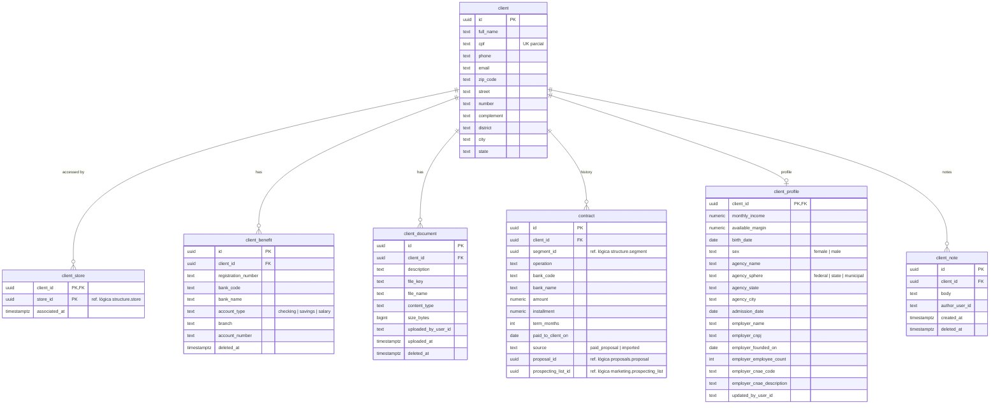

# SmartCorbans — Modelo de dados · Clientes

**Status:** Validado
**Versão:** 0.3
**Data:** 11/10/2026
**Schema:** `clients`
**Base:** CRM · Clientes v0.13; Relacionamentos do CRM v0.2 e do Marketing v0.2; ADR-0023, ADR-0024

## Histórico de revisões

| Versão | Mudanças |
|---|---|
| 0.3 | Novas tabelas `client_profile` (perfil, RN-CLI-14) e `client_note` (Notas, RN-CLI-15): lacunas achadas na modelagem de Leads, aprovadas pelo usuário. |
| 0.2 | Documento do Cliente visível a **qualquer um com acesso ao Cliente** (todas as Lojas associadas); sai o `store_id` do documento. Tipo de conta confirmado. Decisões do usuário. |
| 0.1 | Primeira versão. |

## 1. O que o módulo guarda

O Cliente do tenant, com endereço, Benefícios, Documentos, a associação com as Lojas que o acessam e o histórico de Contratos. Leads, Simulações e Propostas apontam para o Cliente por `client_id`.

## 2. Diagrama

Todas as tabelas têm `created_at` e `updated_at` (omitidos no diagrama).

## 3. Tabelas

### 3.1. `client` (Cliente)

| Coluna | Tipo | Nulo | Regra |
|---|---|---|---|
| `id` | uuid | não | PK. |
| `full_name` | text | não | — |
| `cpf` | text | sim | Só os 11 dígitos. **Único quando preenchido** (índice parcial `WHERE cpf IS NOT NULL`, RN-CLI-02). Preenchido **uma vez**, depois imutável (RN-CLI-11), garantido pela aplicação. |
| `phone` | text | não | Normalizado (só dígitos, com DDD). |
| `email` | text | sim | Opcional no Cliente. |
| `zip_code` … `state` | text | sim | Endereço; CEP preenche o resto pelo ViaCEP, que pode falhar sem bloquear (RN-CLI-07). |

Índice (não único) em `(lower(full_name), phone) WHERE cpf IS NULL`, para achar o Cliente sem CPF por Nome completo + Telefone exatos (RN-CLI-12). **Sem exclusão e sem status**: o Cliente é do tenant e sobrevive à Loja (RN-CLI-10).

### 3.2. `client_store` (Cliente × Loja)

Chave `(client_id, store_id)`. Uma linha nasce **só** quando uma Lead do Cliente é distribuída à Loja (RN-CLI-04), pelo contrato de Clientes chamado por Leads, na mesma transação. Nunca é apagada: excluir a Loja não afeta o Cliente (RN-CLI-10). É **a tabela que o filtro de escopo usa** para o Cliente: com `store` ou `team`, a Loja só vê Clientes que têm linha aqui.

### 3.3. `client_benefit` (Benefício)

Zero ou mais por Cliente (RN-CLI-08): `registration_number` (Matrícula), banco por código + nome (lista do Banco Central), `account_type`, `branch` (Agência), `account_number` (Conta). Exclusão suave.

### 3.4. `client_document` (Documento do Cliente)

Arquivo no Blob Storage, container `client-documents` (ADR-0024). O banco guarda a chave, o nome original, tipo, tamanho, descrição, quem enviou e quando (RF-CLI-04). **Visível a qualquer um com acesso ao Cliente**, de qualquer Loja associada (decisão do usuário); por isso não guarda Loja. Os Documentos da Proposta, ao contrário, ficam restritos à Proposta e a quem a acessa (`proposals`). Exclusão suave; o arquivo permanece enquanto a linha existir.

### 3.5. `client_profile` (perfil do Cliente)

Uma linha por Cliente, criada no primeiro dado de perfil (RN-CLI-14). Vale o último valor informado, venha da Huggy, do operador, da Simulação ou da Lista. Dinheiro em `numeric(14,2)`.

| Grupo | Colunas | Bloco do Layout / campo de Regra |
|---|---|---|
| Financeiro | `monthly_income`, `available_margin` | Dados financeiros; "Margens" |
| Pessoal | `birth_date`, `sex` | "Idade", "Sexo" |
| Servidor | `agency_name`, `agency_sphere`, `agency_state` (UF), `agency_city` | Dados do servidor (RN-LAY-11): `state` quando a esfera é federal ou estadual, `city` quando municipal, `CHECK` garante um ou outro |
| Trabalho | `admission_date` | Dados trabalhistas; "Tempo de emprego" (calculado) |
| Empresa | `employer_name`, `employer_cnpj`, `employer_founded_on`, `employer_employee_count`, `employer_cnae_code`, `employer_cnae_description` | Dados da empresa; "Idade da empresa", "Número de funcionários" |

Idade e tempo de emprego são **calculados** das datas, não gravados. A Matrícula vem de `client_benefit`. Os campos de contratos pré-existentes das Regras saem de `contract`; os de aceitação do banco, da Simulação.

### 3.6. `client_note` (Notas)

Texto, autor e data (RN-CLI-15). Sem edição; o autor exclui (exclusão suave). Visível a quem acessa o Cliente.

### 3.7. `contract` (histórico de Contratos)

| Coluna | Tipo | Nulo | Regra |
|---|---|---|---|
| `client_id` | uuid | não | FK → `client`. |
| `segment_id` | uuid | não | Ref. lógica. Segmento da Proposta (via Lead) ou o alvo da Lista (RN-CLI-13). |
| `operation` | text | não | Um dos quatro valores do catálogo. |
| `bank_code`, `bank_name` | text | sim | Quando conhecido. |
| `amount`, `installment` | numeric(14,2) | sim / sim | Sem Parcela, "sem dados para análise" na Carteira Ativa (RN-CRA-02). |
| `term_months` | int | sim | Idem. |
| `paid_to_client_on` | date | sim | Base do prazo restante e do Filtro de base da Varredura. |
| `source` | text | não | `paid_proposal` \| `imported`. |
| `proposal_id` | uuid | sim | Ref. lógica. **Único quando preenchido** (1:1 com a Proposta Paga, RN-PRP-18). `CHECK (source <> 'paid_proposal' OR proposal_id IS NOT NULL)`. |
| `prospecting_list_id` | uuid | sim | Ref. lógica à Lista que importou (RN-PRS-15). |

O Contrato de Proposta Paga é **atualizado** quando a Proposta é editada depois do Pago (RN-PRP-18), por evento de Propostas. Índice em `(client_id, segment_id, paid_to_client_on DESC)` para a Varredura achar o último Contrato do Cliente no Segmento (RN-CRA-02). As Lojas nunca leem esta tabela (RN-CLI-13).

## 4. Fora deste schema

| O quê | Onde |
|---|---|
| Leads, Simulações, Propostas do Cliente | `leads`, `simulation`, `proposals` |
| Conversas | Huggy (só a associação, em `messaging`) |
| Arquivos dos Documentos | Blob Storage (ADR-0024) |

## 5. Decisões deste modelo

1. **CPF só com dígitos e único só quando preenchido.** A busca do Cliente sem CPF por Nome + Telefone usa índice comum; quem impede a duplicata é a aplicação, que reaproveita o Cliente encontrado em vez de criar outro (RN-CLI-12).
2. **Documento do Cliente é do Cliente**, visível a toda Loja associada; o da Proposta é da Proposta (decisão do usuário).
3. **Tipo de conta do Benefício** com três valores (`checking` corrente, `savings` poupança, `salary` conta salário/benefício), confirmados pelo usuário.
4. **Cliente sem exclusão nem status.**
5. **Perfil numa tabela 1:1 com colunas tipadas**, porque o motor de Simulação e a pré-análise comparam esses valores; idade e tempo de emprego calculados.
