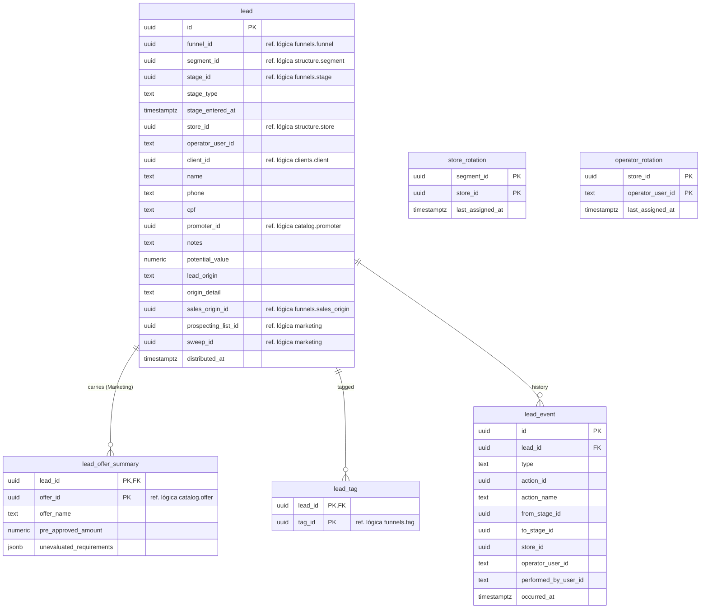

# SmartCorbans — Modelo de dados · Leads e Distribuição

**Status:** Validado
**Versão:** 0.2
**Data:** 11/10/2026
**Schema:** `leads`
**Base:** CRM · Leads v0.12; Admin · Funis de Vendas v0.17, Layout de Lead v0.7, Lojas v0.15; Marketing (RN-MKT-01, 08); Relacionamentos do CRM v0.2; ADR-0012, ADR-0023

## Histórico de revisões

| Versão | Mudanças |
|---|---|
| 0.2 | Lacunas resolvidas: perfil e Notas ficam no Cliente (`clients.client_profile`, `clients.client_note`; Clientes v0.13). |
| 0.1 | Primeira versão. |

## 1. O que o módulo guarda

A Lead, o resumo das Ofertas que a Lead do Marketing traz, as Tags dela, o histórico de eventos (Ações, distribuição, atribuição) e o estado dos dois rodízios (Lojas e operadores). O débito fica em `credits`, a Proposta em `proposals`, a conversa em `messaging`.

## 2. Diagrama

`lead` tem também `created_at` e `updated_at`.

## 3. Tabelas

### 3.1. `lead`

| Coluna | Tipo | Nulo | Regra |
|---|---|---|---|
| `id` | uuid | não | PK. |
| `funnel_id`, `segment_id` | uuid | não | Refs. lógicas. O Segmento é guardado junto do Funil porque é o que a distribuição usa (RN-LED-02). |
| `stage_id` | uuid | não | Ref. lógica → `funnels.stage`. Só muda por Ação ou pela Proposta (RN-LED-11, RN-FNL-18). |
| `stage_type` | text | não | **Cópia** do tipo do Stage atual (`new` … `cancelled`). Leads decide muita coisa pelo tipo (em curso, Formalização, terminal, Recontato) e não pode ler `funnels`; Funis avisa por evento se o tipo de um Stage mudar. |
| `stage_entered_at` | timestamptz | não | Quando entrou no Stage atual. Lead **parada** = mais de 3 dias (RN-LED-15). |
| `store_id` | uuid | sim | Ref. lógica. Vazio só em trânsito no rodízio (RN-LED-01). **Coluna do filtro de escopo** (ADR-0012). |
| `operator_user_id` | text | sim | Id do Keycloak. Vazio = pool da Loja (RN-LED-05). |
| `client_id` | uuid | sim | Ref. lógica. Preenchido quando a Lead reúne Nome + CPF + Telefone (RN-CLI-01). |
| `name`, `phone` | text | não | Dados mínimos. |
| `cpf` | text | sim | Só dígitos. |
| `promoter_id` | uuid | sim | Ref. lógica. Pré-preenche a Simulação (RN-SIM-06). |
| `notes` | text | sim | Observações do cadastro. |
| `potential_value` | numeric(14,2) | sim | Digitado na Manual; gravado pelo sistema e somente leitura nas do Marketing (RN-LED-16). |
| `lead_origin` | text | não | `campaign` \| `organic` \| `recontact` \| `prospecting` \| `active_portfolio` \| `manual`. **Imutável** (RN-LED-12). |
| `origin_detail` | text | sim | Complemento da Origem: canal da Huggy, landing page ou autor (RN-LED-12). |
| `sales_origin_id` | uuid | sim | Ref. lógica. Editável (RN-ORI-06). |
| `prospecting_list_id` | uuid | sim | Ref. lógica. **Imutável.** `CHECK (lead_origin = 'prospecting') = (prospecting_list_id IS NOT NULL)`. |
| `sweep_id` | uuid | sim | Ref. lógica. Imutável. Mesmo `CHECK` para `active_portfolio`. |
| `distributed_at` | timestamptz | sim | Quando caiu na Loja. É também a data de injeção que o Dashboard do Marketing usa (RN-DMB-02). |

Índices: `(store_id, funnel_id, stage_id)` para o board; `(operator_user_id)`; `(client_id)`; `(cpf)` e `(phone)` para identificar Recontato; `(prospecting_list_id)` e `(sweep_id)` para o Dashboard do Marketing; parcial `(client_id, segment_id) WHERE stage_type IN ('new','negotiation','formalization')` para a duplicidade do Marketing (RN-MKT-04).

A Lead **não é excluída**; o fim dela é um Stage terminal.

### 3.2. `lead_offer_summary`

Uma linha por Oferta elegível na pré-análise, gravada na injeção, **somente leitura** (RN-LED-16): nome da Oferta copiado, valor pré-aprovado e a lista de requisitos não avaliados (`jsonb`, só exibição). O `potential_value` da Lead é o maior `pre_approved_amount` (RN-MKT-08).

### 3.3. `lead_tag`

Tags da Huggy na Lead (Card, slot 4). Chave `(lead_id, tag_id)`.

### 3.4. `lead_event` (histórico)

**Append-only.** Alimenta o bloco Histórico do Sheet (Ação executada, data, quem, Layout §3.3) e o cálculo de Lead parada.

| `type` | Quando |
|---|---|
| `created` | Nasce a Lead. |
| `distributed` | Cai numa Loja (rodízio, Recontato ou Manual). |
| `assigned` | Ganha ou troca de operador (rodízio, manual, auto-assunção, redistribuição por inativação). |
| `action` | Uma Ação foi executada; guarda `action_id` e o **nome** da Ação como texto. |
| `moved_by_proposal` | A Proposta chegou a Pago ou Cancelado e moveu a Lead (RN-FNL-18). |

### 3.5. Rodízios

| Tabela | Chave | Uso |
|---|---|---|
| `store_rotation` | `(segment_id, store_id)` | Entre as Lojas elegíveis, recebe a de `last_assigned_at` mais antigo (nulo primeiro); atualizado a cada atribuição bem-sucedida (RN-LED-03, RN-LED-08). |
| `operator_rotation` | `(store_id, operator_user_id)` | Mesmo critério entre os operadores elegíveis da Loja (RN-LED-04). |

Recontato e Manual não mexem nos rodízios (RN-LED-08). A atribuição e o débito acontecem na **mesma transação** (ADR-0012), com bloqueio da linha do rodízio para duas Leads simultâneas não irem para a mesma Loja por engano.

## 4. Fora deste schema

| O quê | Onde |
|---|---|
| Débito da Lead | `credits` (com `lead_id`) |
| Proposta da Lead (0..1) | `proposals` (com `lead_id` único) |
| Conversa da Lead (1:1) | `messaging` |
| Simulações da Lead | `simulation` |
| Elegibilidade do operador (Time, "Pode receber lead") | Keycloak, até o debate de Acesso |

## 5. Decisões deste modelo

1. **Tipo do Stage copiado na Lead**, mantido por evento de Funis, para Leads não ler outro schema.
2. **Rodízio entre Lojas por Segmento.** A spec não diz se a fila é única ou por Segmento; por Segmento evita que uma Loja que opera vários Segmentos "perca a vez" num por ter recebido em outro.
3. **Histórico de eventos próprio**, append-only, com o nome da Ação como texto.
4. **Lead sem exclusão.**

## 6. Lacunas encontradas na spec

Resolvidas na v0.2: os dados de perfil e as Notas são do Cliente (Clientes v0.13, RN-CLI-14 e RN-CLI-15; modelo de Clientes v0.3).
