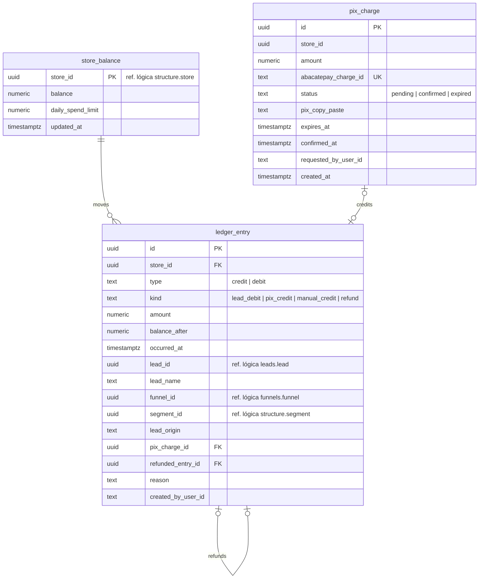

# SmartCorbans — Modelo de dados · Créditos

**Status:** Validado
**Versão:** 0.2
**Data:** 11/10/2026
**Schema:** `credits`
**Base:** CRM · Créditos v0.7; Admin · Lojas v0.15 (RN-LOJ-11 a 13); Leads (RN-LED-02, 03, 13); ADR-0011, ADR-0012, ADR-0023

## Histórico de revisões

| Versão | Mudanças |
|---|---|
| 0.2 | Débito identificado por Segmento e Origem da lead, sem Produto (Créditos v0.7, decisão do usuário). Coluna `segment_id` no lançamento. |
| 0.1 | Primeira versão. |

## 1. O que o módulo guarda

O saldo de cada Loja, o Extrato append-only e as cobranças Pix no AbacatePay. A flag "Pode receber lead sem saldo" é da Loja (`structure.store`) e chega ao débito pelo contrato de Estrutura.

## 2. Diagrama

## 3. Tabelas

### 3.1. `store_balance` (Saldo)

| Coluna | Tipo | Nulo | Regra |
|---|---|---|---|
| `store_id` | uuid | não | PK. Ref. lógica → `structure.store`. Criado com a Loja, saldo `0`. |
| `balance` | numeric(14,2) | não | Saldo atual. Negativo só em Loja com a flag (RN-CRD-03), regra da aplicação, porque a flag está em outro schema. |
| `daily_spend_limit` | numeric(14,2) | sim | Limite de gasto diário, editável pela Loja (RN-CRD-07). |
| `updated_at` | timestamptz | não | — |

**Concorrência** (Créditos §9, item 1): todo lançamento trava a linha do saldo (`SELECT … FOR UPDATE`), confere o saldo e o limite do dia, grava o lançamento e atualiza o saldo, **na mesma transação da atribuição da Lead** (ADR-0012). Duas Leads simultâneas para a mesma Loja ficam em fila nessa linha; a segunda vê o saldo já debitado.

### 3.2. `ledger_entry` (Extrato)

**Append-only**: sem `UPDATE` nem `DELETE` (RN-CRD-06). O papel do banco usado pela API não tem essas permissões nesta tabela.

| Coluna | Tipo | Nulo | Regra |
|---|---|---|---|
| `id` | uuid | não | PK. |
| `store_id` | uuid | não | FK → `store_balance`. **Coluna do filtro de escopo.** |
| `type` | text | não | `credit` \| `debit`. |
| `kind` | text | não | `lead_debit` (débito) ou `pix_credit`, `manual_credit`, `refund` (créditos). Origem sempre identificada (RN-CRD-08). |
| `amount` | numeric(14,2) | não | Sempre positivo; o sinal vem de `type`. |
| `balance_after` | numeric(14,2) | não | Saldo depois do lançamento (Créditos §3.2). |
| `occurred_at` | timestamptz | não | — |
| `lead_id` | uuid | sim | Ref. lógica. Obrigatório em `lead_debit`; **único** entre os `lead_debit` (um débito por Lead). |
| `lead_name` | text | sim | Nome do contato no momento, para os Detalhes da operação. |
| `funnel_id`, `segment_id`, `lead_origin` | uuid / text | sim | O que definiu o preço; Segmento e Origem são os filtros do Extrato (Créditos v0.7). |
| `pix_charge_id` | uuid | sim | FK → `pix_charge`. Obrigatório e **único** em `pix_credit`. |
| `refunded_entry_id` | uuid | sim | FK → `ledger_entry`. Obrigatório e **único** em `refund`: um estorno por débito. |
| `reason` | text | sim | Nota do crédito manual ou motivo do estorno. |
| `created_by_user_id` | text | sim | Quem adicionou o crédito manual ou fez o estorno (Admin, RN-LOJ-11, RN-LOJ-13). |

`CHECK` amarra cada `kind` às colunas obrigatórias. Índices: `(store_id, occurred_at DESC)` para o Extrato e para o **gasto do dia** (soma dos débitos da Loja desde 00h de Brasília, RN-CRD-07); `(lead_id)`; `(funnel_id)` e `(lead_origin)` para a Receita de leads do Dashboard do Marketing (RN-DMB-05).

### 3.3. `pix_charge` (cobrança Pix)

| Coluna | Tipo | Nulo | Regra |
|---|---|---|---|
| `id` | uuid | não | PK. |
| `store_id` | uuid | não | Ref. lógica. |
| `amount` | numeric(14,2) | não | — |
| `abacatepay_charge_id` | text | não | **Único.** É a chave de idempotência do webhook de confirmação (ADR-0011): webhook repetido não credita duas vezes. |
| `status` | text | não | `pending` \| `confirmed` \| `expired` (Créditos §6). Só `confirmed` gera lançamento. |
| `pix_copy_paste` | text | não | Código "copia e cola" devolvido pelo AbacatePay; o QR é desenhado no front a partir dele. |
| `expires_at` | timestamptz | não | O Worker marca `expired` as vencidas. |
| `confirmed_at` | timestamptz | sim | — |
| `requested_by_user_id` | text | não | Quem gerou a cobrança na Loja. |

## 4. Decisões deste modelo

1. **Saldo guardado** (e não só somado do Extrato), com `balance_after` em cada lançamento, como a spec pede; a trava da linha do saldo resolve a concorrência.
2. **Extrato protegido no banco** contra `UPDATE` e `DELETE`, além da regra da aplicação.
3. **Unicidades que a spec implica**: um débito por Lead, um estorno por débito, um crédito por cobrança Pix.
4. **Gasto do dia calculado** do Extrato, sem contador separado.

## 5. Lacuna na spec

Resolvida na v0.2: o débito não tem Produto; é identificado por Segmento e Origem da lead (Créditos v0.7).
