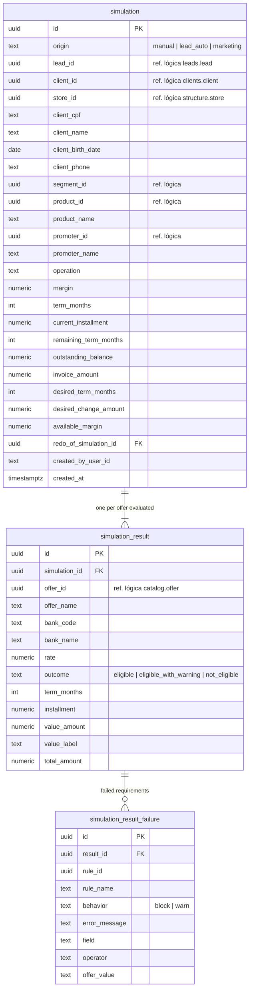

# SmartCorbans — Modelo de dados · Motor de Simulação

**Status:** Validado
**Versão:** 0.2
**Data:** 11/10/2026
**Schema:** `simulation`
**Base:** CRM · Simulações v0.14; Admin · Ofertas v0.15, Regras v0.9; Marketing (RN-MKT-02); ADR-0023

## Histórico de revisões

| Versão | Mudanças |
|---|---|
| 0.2 | Visibilidade decidida: cada Loja vê o seu lado (RN-CLI-04, RN-CLI-09); Simulações v0.14 corrigida. |
| 0.1 | Primeira versão. |

## 1. O que o módulo guarda

A Simulação como **snapshot imutável**: os dados do cliente e da operação informados, e o resultado por Oferta avaliada, com os requisitos que falharam. O motor lê Ofertas e Regras pelo contrato do Catálogo; a pré-análise do Marketing usa o mesmo motor sem gravar aqui (RN-MKT-02), e só a Lead injetada com Oferta aprovada vira Simulação de origem `marketing`.

## 2. Diagrama

## 3. Tabelas

### 3.1. `simulation`

**Imutável**: só `INSERT` (Simulações §3.1). Refazer cria outra linha, com `redo_of_simulation_id` apontando a anterior (RN-SIM-09).

| Grupo | Colunas | Regra |
|---|---|---|
| Disparo | `origin`, `created_by_user_id` (nulo = Sistema), `created_at` | Três origens (RN-SIM-01). |
| Vínculos | `lead_id`, `client_id`, `store_id` | Refs. lógicas, opcionais. `client_id` só se o CPF é de Cliente associado à Loja (RN-SIM-05). `store_id` = Loja do operador; nulo na origem `marketing`, que fica visível pela Lead e pelo Cliente. |
| Cliente (inline) | `client_cpf`, `client_name`, `client_birth_date`, `client_phone` | Sempre gravados, cadastrado ou não (RN-SIM-05). CPF vazio se o Cliente do Marketing não tem. |
| Operação | `segment_id`, `product_id` + `product_name`, `promoter_id` + `promoter_name`, `operation` | O motor avalia **todas** as Ofertas que combinam os quatro (RN-SIM-06). Nomes copiados porque é snapshot. |
| Contrato atual e preferências | `margin`, `term_months`, `current_installment`, `remaining_term_months`, `outstanding_balance`, `invoice_amount`, `desired_term_months`, `desired_change_amount`, `available_margin` | Usadas conforme a Operação (RN-SIM-07); as que não se aplicam ficam nulas. |

Índices: `(client_id, created_at DESC)` para o histórico na ficha; `(lead_id)`; `(store_id)`.

### 3.2. `simulation_result`

Uma linha por Oferta avaliada, com o **snapshot da Oferta** (nome, banco, taxa) e o cálculo (prazo, parcela, valor). `value_label` diz qual valor é exibido conforme a Operação: Valor liberado, Troco liberado ou Valor financiado (RN-SIM-10). `outcome` separa elegível, elegível com alerta (Regra de aviso) e não elegível (Regra bloqueante).

### 3.3. `simulation_result_failure`

Um requisito que falhou, com a Regra (id e nome copiados), o comportamento **efetivo** naquela Oferta, a mensagem de erro, o campo, o operador e o **valor definido pela Oferta** como texto já formatado ("maior ou igual a 21"), para exibir sem reconstruir (RN-SIM-11).

## 4. Decisões deste modelo

1. **Snapshot completo em colunas**, com os nomes copiados: mudar ou excluir Oferta, Regra, Produto ou Promotora não altera a Simulação (Simulações §3.1, RN-OFR-05).
2. **Entradas da simulação em colunas tipadas** (nulas quando a Operação não as usa), em vez de JSON, para os relatórios e a Proposta lerem direto.
3. **Simulação sem Loja na origem Marketing**: ela é anterior à distribuição.
4. **"Refazer" ligado à anterior** por `redo_of_simulation_id`, só para rastreio.

## 5. Visibilidade

Cada Loja vê o seu lado (Clientes, RN-CLI-04 e RN-CLI-09; Simulações v0.14): as Simulações com `store_id` da própria Loja e as de origem `marketing` cujas Leads ela recebeu. O filtro de escopo aplica essa regra.
