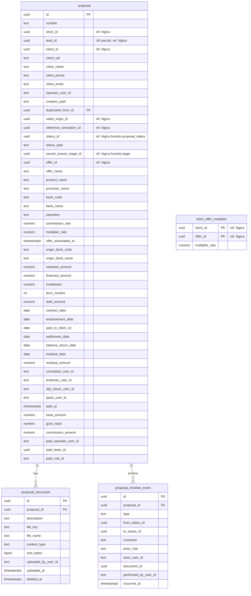

# SmartCorbans — Modelo de dados · Propostas

**Status:** Validado
**Versão:** 0.3
**Data:** 11/10/2026
**Schema:** `proposals`
**Base:** CRM · Propostas v0.14, Tabelas Multiplicadoras v0.6; Admin · Ofertas v0.16 (RN-OFR-07), Status de Proposta v0.7; ADR-0023, ADR-0024

## Histórico de revisões

| Versão | Mudanças |
|---|---|
| 0.3 | Portabilidade usa o Valor financiado como valor base; Saque complementar é Novo (Ofertas v0.16, decisão do usuário). |
| 0.2 | Valores da operação: a Proposta tem **Valor liberado, Valor financiado e Valor da dívida**, todos disponíveis em qualquer Operação; o valor base só escolhe um deles conforme a Operação (decisão do usuário). |
| 0.1 | Primeira versão. |

## 1. O que o módulo guarda

A Proposta, com o snapshot da Oferta, a atribuição gravada no Pago, os Atores, Documentos e a Linha do tempo; e a Tabela de Multiplicadores da Loja. O Contrato gerado no Pago fica em `clients.contract` (RN-PRP-18).

## 2. Diagrama

## 3. Tabelas

### 3.1. `proposal`

| Grupo | Colunas | Regra |
|---|---|---|
| Identificação | `id`, `number` | `number` opcional ("-" até ser atribuído). |
| Escopo | `store_id` | Loja do Operador. **Coluna do filtro de escopo.** |
| Lead | `lead_id` | Opcional; **único quando preenchido** (RN-PRP-01). |
| Cliente | `client_id` **ou** `client_cpf`, `client_name`, `client_phone`; `client_email` | `CHECK (client_id IS NOT NULL OR client_cpf IS NOT NULL)`: toda Proposta tem Cliente, por referência ou inline. O e-mail é pedido no formulário da Proposta. |
| Responsável | `operator_user_id` | Recebe o crédito da venda (RN-PRP-16). |
| Origem | `creation_path` (`formalization` \| `manual` \| `duplicate` \| `import`), `duplicated_from_id`, `sales_origin_id`, `reference_simulation_id` | Origem de Venda copiada da Lead na criação e depois independente (RN-PRP-13). |
| Status | `status_id`, `status_type`, `cancel_reason_stage_id` | `status_type` é **cópia** do Tipo do Status, mantida por evento de Funis (mudar o Tipo reclassifica, RN-STP-04). O Motivo é o Stage Cancelado escolhido (RN-PRP-04). |
| Oferta (snapshot) | `offer_id`, `offer_name`, `product_name`, `promoter_name`, `bank_code`, `bank_name`, `operation`, `commission_rate`, `multiplier_rate`, `offer_associated_at` | Gravado ao associar e a cada troca (RN-PRP-05, RN-PRP-07, RN-MUT-04). Vazio só em `new`. Travado em `paid` e `cancelled` (RN-PRP-15). |
| Portabilidade | `origin_bank_code`, `origin_bank_name` | Obrigatório em Portabilidade e Portabilidade com Refinanciamento (RN-PRP-14). |
| Valores | `released_amount` (Valor liberado), `financed_amount` (Valor financiado, o "Valor do contrato" da spec), `debt_amount` (Valor da dívida) | **Todos existem em qualquer Operação**; quais o operador preenche depende do caso. O valor base usa um deles conforme a Operação (§5). |
| Contrato | `installment`, `term_months`, as cinco datas, `residual_date`, `residual_amount` | Editáveis em qualquer Status (RN-PRP-15). Com os valores, alimentam o Contrato (RN-PRP-18). |
| Atores | `consultant_user_id`, `endorser_user_id`, `slip_issuer_user_id`, `typist_user_id` | Cada um trava ao ser atribuído (RN-PRP-09). Entram no escopo `self` (RN-PRP-17). |
| Pago | `paid_at`, `base_amount`, `goal_value`, `commission_amount`, `paid_operator_user_id`, `paid_team_id`, `paid_role_id` | Gravados na primeira chegada a Pago (RN-PRP-05). `goal_value = base_amount × multiplier_rate`; `commission_amount = base_amount × commission_rate`. Metas, Rankings, Dashboard e Relatórios leem estas colunas. |

**Nunca é excluída** (RN-PRP-08). Índices: `(store_id, status_type)`; `(operator_user_id)` e um por coluna de Ator, para o escopo `self`; `(client_id)`; `(paid_at)` com `(paid_team_id)` e `(paid_operator_user_id)` para Metas e Rankings.

### 3.2. `proposal_document`

Mesma forma de `clients.client_document`, container `proposal-documents` (ADR-0024). **Restrito à Proposta** e a quem a acessa (RN-PRP-11).

### 3.3. `proposal_timeline_event` (Linha do tempo)

Append-only, gerada pelo sistema (RN-PRP-12): `type` = `created`, `status_changed` (com de/para e o comentário opcional, RN-PRP-10), `offer_changed`, `actor_assigned` (papel e pessoa), `document_added`, `document_removed`, `paid`, `field_changed`.

### 3.4. `store_offer_multiplier` (Tabela de Multiplicadores)

Chave `(store_id, offer_id)`. **Sem linha = 100%** (RN-MUT-01 a 03). Sem mínimo nem máximo (RN-MUT-02). Editar vai para a Auditoria (RNF005, grupo Dinheiro). Quando a Oferta é excluída, as linhas ficam, inofensivas.

## 4. Decisões deste modelo

1. **Snapshot da Oferta e atribuição do Pago em colunas da própria Proposta**, não em tabelas à parte: são 1:1 e lidas o tempo todo.
2. **Tipo do Status copiado**, pela mesma razão do Stage na Lead.
3. **Atores como quatro colunas**, porque são quatro papéis fixos.
4. **`base_amount` gravado no Pago**, para Metas e Comissões não dependerem de recalcular.

## 5. Valor base

A Proposta guarda os três valores; o **valor base** (RN-OFR-07) é **um deles, escolhido pela Operação** da Oferta, e é copiado em `base_amount` no Pago:

| Operação | Valor base | Coluna |
|---|---|---|
| Novo | Valor liberado | `released_amount` |
| Refinanciamento | Valor financiado | `financed_amount` |
| Portabilidade | Valor financiado | `financed_amount` |
| Portabilidade com Refinanciamento | Valor financiado | `financed_amount` |

A tabela segue a RN-OFR-07 (Ofertas v0.16). Compra de Dívida é Portabilidade, e Saque complementar é Novo.
