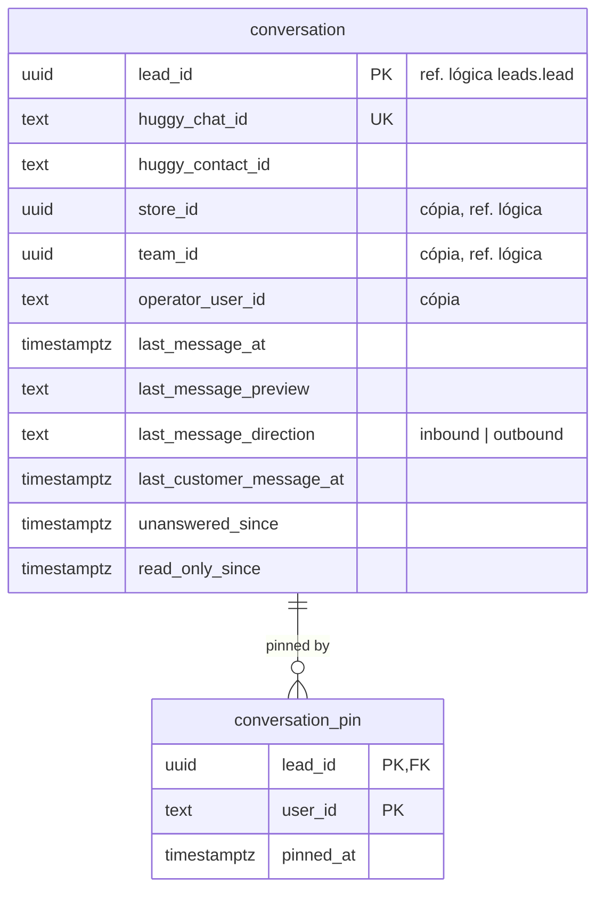

# SmartCorbans — Modelo de dados · Atendimento

**Status:** Validado
**Versão:** 0.2
**Data:** 11/10/2026
**Schema:** `messaging`
**Base:** CRM · Chat v0.8; Leads (RF-LED-03); Layout de Lead (Card slot 6, Dados adicionais); ADR-0010, ADR-0011, ADR-0023

## Histórico de revisões

| Versão | Mudanças |
|---|---|
| 0.2 | O trecho da última mensagem fica guardado, por usabilidade (decisão do usuário; Chat v0.8). |
| 0.1 | Primeira versão. |

## 1. O que o módulo guarda

**Mensagens não são guardadas**: vivem na Huggy e são lidas ao abrir a conversa (Chat §3.1). O schema guarda só a **associação Conversa ↔ Lead** e um **resumo** atualizado pelos webhooks da Huggy, necessário para listar, ordenar e filtrar as conversas por escopo sem chamar a Huggy para cada uma, e para aplicar a janela de 24h. Mais a fixação individual.

## 2. Diagrama

## 3. Tabelas

### 3.1. `conversation`

| Coluna | Regra |
|---|---|
| `lead_id` | PK: **1:1 com a Lead** (Chat §3.1). |
| `huggy_chat_id`, `huggy_contact_id` | Ids na Huggy, exibidos em Dados adicionais (Layout §3.3). `huggy_chat_id` único: é como o webhook acha a conversa. |
| `store_id`, `team_id`, `operator_user_id` | **Cópias** da Lead, atualizadas por evento de Leads (distribuição, troca de operador). Servem ao filtro de escopo `self`/`team`/`store` (RN-CHT-03) e aos filtros de Time e Operador (RN-CHT-06) sem ler `leads`. |
| `last_message_at`, `last_message_preview`, `last_message_direction` | Resumo para a lista, atualizado por webhook. |
| `last_customer_message_at` | Base da **janela de 24h** (RN-CHT-10): passou de 24h, só Template. |
| `unanswered_since` | Mensagem do cliente ainda sem resposta; alimenta o Card (slot 6, "Última mensagem recebida sem resposta"). Limpo quando sai mensagem do operador. |
| `read_only_since` | Preenchido quando a Lead chega a Pago ou Cancelado (RN-CHT-05). |

Índices: `(store_id, last_message_at DESC)`, `(operator_user_id)`, `(team_id)`.

### 3.2. `conversation_pin`

Fixação **individual** (RN-CHT-09): chave `(lead_id, user_id)`.

## 4. Decisões deste modelo

1. **Resumo local da conversa**, com só o trecho da última mensagem (decisão do usuário, Chat v0.8), para a lista e a regra de 24h funcionarem sem uma chamada à Huggy por conversa. O conteúdo continua só na Huggy.
2. **Escopo copiado da Lead** (Loja, Time, operador), como o tipo do Stage na Lead.
3. **Webhook idempotente** pelo id da mensagem na Huggy (ADR-0011), sem gravar a mensagem: o registro de ids processados fica no componente Webhooks, não aqui.
