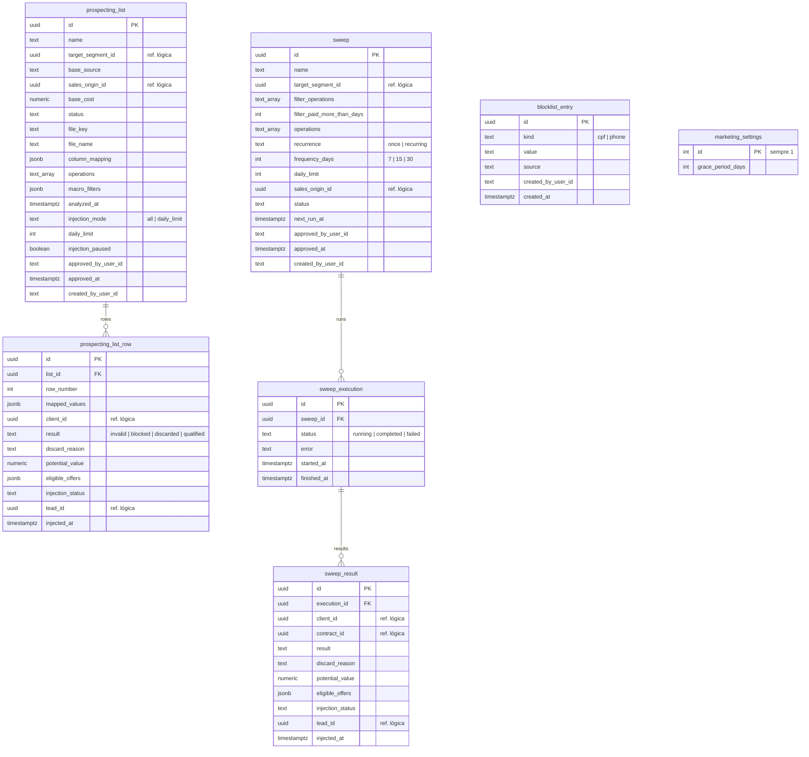

# SmartCorbans — Modelo de dados · Marketing

**Status:** Validado
**Versão:** 0.1
**Data:** 11/10/2026
**Schema:** `marketing`
**Base:** Marketing v0.9, Prospecção v0.8, Carteira Ativa v0.9; Relacionamentos do Marketing v0.2; ADR-0007, ADR-0008, ADR-0023, ADR-0024

## Histórico de revisões

| Versão | Mudanças |
|---|---|
| 0.1 | Primeira versão. |

## 1. O que o módulo guarda

Listas de Prospecção com as linhas importadas e o resultado de cada uma; Varreduras com as execuções e o resultado por Cliente; a Lista de bloqueio e a carência. A **fila de injeção não é tabela**: é o conjunto de linhas e resultados qualificados ainda não injetados (Relacionamentos do Marketing). O Worker processa importação, pré-análise, execuções e injeção (ADR-0007, ADR-0008). Clientes, Contratos importados, Leads e Simulações são criados nos módulos donos, pelos contratos deles.

## 2. Diagrama

## 3. Tabelas

### 3.1. `prospecting_list` (Lista de Prospecção)

| Grupo | Colunas | Regra |
|---|---|---|
| Cadastro | `name`, `target_segment_id`, `base_source`, `sales_origin_id`, `base_cost` | Prospecção §3.1. `base_cost` alimenta o Dashboard financeiro (RN-DMB-05). |
| Estado | `status` | `pending_mapping` \| `processing` \| `awaiting_approval` \| `stored` \| `injecting` \| `completed` \| `failed` \| `cancelled` (Prospecção §6). |
| Arquivo | `file_key`, `file_name`, `column_mapping` | Arquivo no Blob, container `marketing-imports` (ADR-0024). O mapeamento fica guardado para reprocessar. |
| Pré-análise | `operations`, `macro_filters`, `analyzed_at` | `analyzed_at` + 7 dias = validade; passou, exige reprocessar antes de distribuir (RN-PRS-09). |
| Injeção | `injection_mode`, `daily_limit`, `injection_paused`, `approved_by_user_id`, `approved_at` | Ritmo e controle (RN-PRS-07). A aprovação vai para a Auditoria (RNF005, grupo Dinheiro). |
| Autoria | `created_by_user_id` | Recebe a notificação de Falha (RN-MKT-10). |

Não se exclui se tiver Leads (RN-PRS-17); sem Leads, exclusão suave (`deleted_at`).

### 3.2. `prospecting_list_row` (linha da Lista)

| Coluna | Regra |
|---|---|
| `row_number`, `mapped_values` | Posição no arquivo e valores já mapeados para os campos do catálogo (`jsonb`), entrada do motor e da criação do Cliente. |
| `client_id` | Cliente criado ou reaproveitado; nulo em `invalid` e `blocked` (RN-PRS-16). |
| `result`, `discard_reason` | Resultado da pré-análise (RN-PRS-05); o motivo é a mensagem de erro da Regra bloqueante (RN-PRS-03). |
| `potential_value`, `eligible_offers` | Valor potencial e Ofertas elegíveis com os requisitos não avaliados (RN-MKT-08); copiados para a Lead na injeção (`leads.lead_offer_summary`). |
| `injection_status` | `pending` (na fila) \| `injected` \| `refused_grace` \| `refused_duplicate` \| `refused_blocked` \| `cancelled`. Só linhas `qualified` entram na fila. Revalidado na hora de injetar (RN-PRS-08). |
| `lead_id`, `injected_at` | A Lead criada e quando. |

Índices: `(list_id, result)`, `(list_id, injection_status)`, `(client_id)`. Os **contadores** do resultado (RF-PRS-03) são contagens sobre esta tabela.

### 3.3. `sweep` (Varredura)

| Grupo | Colunas | Regra |
|---|---|---|
| Cadastro | `name`, `target_segment_id`, `sales_origin_id` | Carteira Ativa §3.1. |
| Filtro de base | `filter_operations`, `filter_paid_more_than_days` | Sobre o **último Contrato** do Cliente no Segmento: Operação e tempo desde a Data de pagamento ao cliente. |
| Simulação | `operations` | Operações a simular. |
| Recorrência | `recurrence`, `frequency_days`, `daily_limit`, `next_run_at` | Recorrente exige frequência e limite diário (RN-CRA-07, RN-CRA-08); roda às 00h de Brasília, e o Worker usa `next_run_at`. |
| Estado | `status` | `draft` \| `processing` \| `awaiting_approval` \| `running` (Única) \| `active` \| `paused` (Recorrente) \| `completed` \| `failed` \| `cancelled` (Carteira Ativa §6). |
| Aprovação e autoria | `approved_by_user_id`, `approved_at`, `created_by_user_id` | Primeira execução aprovada (RN-CRA-07); mudar o universo exige reaprovar (RN-CRA-09). |

### 3.4. `sweep_execution` e `sweep_result`

Cada execução é um registro, com status e erro: base da notificação de falha de execução recorrente (RN-MKT-10). `sweep_result` tem uma linha por Cliente avaliado, com o Contrato usado (RN-CRA-02), o resultado (`eligible` \| `no_data` \| `discarded` \| `refused_grace` \| `refused_active_lead` \| `refused_open_proposal` \| `refused_blocked`), as Ofertas elegíveis e o mesmo controle de injeção da linha da Lista. O que sobra na fila quando chega a próxima execução é reavaliado nela (RN-CRA-07).

### 3.5. `blocklist_entry` (Lista de bloqueio)

CPF (só dígitos) ou telefone (normalizado), com a fonte (`manual` ou o nome do arquivo importado), quem e quando (RF-PRS-07). **Único por `(kind, value)`**. Remover apaga a linha; a mudança vai para a Auditoria.

### 3.6. `marketing_settings`

Uma linha só (`id = 1`, `CHECK`), com `grace_period_days`, padrão 90 (RN-MKT-04, RF-PRS-08).

## 4. Duplicidade na injeção

Checada no momento de injetar cada contato (RN-MKT-04), pelos contratos dos donos:
- **Lead ativa no Segmento** e **injeção nos últimos N dias**: Leads (índice de `leads.lead` por Cliente e Segmento, e Leads de Origem do Marketing por `distributed_at`).
- **Proposta em andamento**: Propostas.
- **Lista de bloqueio**: aqui.

## 5. Decisões deste modelo

1. **Linhas e resultados como registros**, não arquivo reprocessado a cada tela: o resultado, a fila e o Dashboard leem daqui.
2. **Valores mapeados e Ofertas elegíveis em `jsonb`**: o conjunto de campos varia por Lista e só é lido inteiro (motor e cópia para a Lead).
3. **Contadores calculados** por contagem, sem colunas de contador.
4. **Configuração como tabela de linha única**, porque a instância é single-tenant.
