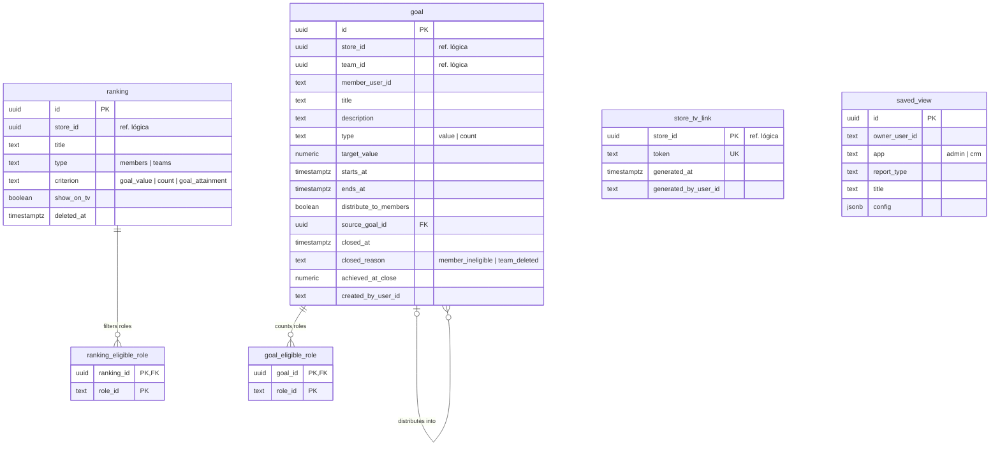

# SmartCorbans — Modelo de dados · Desempenho

**Status:** Validado
**Versão:** 0.1
**Data:** 11/10/2026
**Schema:** `performance`
**Base:** CRM · Metas v0.8, Rankings v0.5, Relatórios, Dashboard; Admin · Relatórios v0.7, Dashboard; Marketing · Dashboard v0.3; ADR-0012, ADR-0023

## Histórico de revisões

| Versão | Mudanças |
|---|---|
| 0.1 | Primeira versão. |

## 1. O que o módulo guarda

Só o que é **configuração** de quem acompanha resultado: Metas, Rankings, o link do Modo TV e as Visões salvas. **Os números não são gravados aqui**: progresso de Meta, posição no Ranking, Dashboards e Relatórios são **calculados** das Propostas Pagas (atribuição gravada no Pago, RN-SC-06), das Leads e do Extrato, por SQL sobre **visões de leitura** que cada módulo dono expõe, sempre com o filtro de escopo (ADR-0012).

## 2. Diagrama

Todas as tabelas de cadastro têm `created_at` e `updated_at` (omitidos no diagrama).

## 3. Tabelas

### 3.1. `goal` (Meta)

| Coluna | Regra |
|---|---|
| `store_id` | Loja da Meta. **Coluna do filtro de escopo.** |
| `team_id`, `member_user_id` | **Exatamente um** (`CHECK`, RN-MET-01). |
| `type`, `target_value` | Tipo travado após criar (RN-MET-05). Na individual distribuída, `target_value` é derivado (RN-MET-07) e travado. |
| `starts_at`, `ends_at` | Prazo (RN-MET-04). `CHECK (starts_at < ends_at)`. |
| `distribute_to_members` | Só em Meta de Time, decidido na criação (RN-MET-06). |
| `source_goal_id` | FK para a Meta de Time de origem, nas individuais geradas por distribuição. |
| `closed_at`, `closed_reason` | Encerramento **antecipado**: Membro deixou de ser elegível (RN-MET-10) ou Time excluído (RN-MET-12). Nunca se exclui. |
| `achieved_at_close` | O atingido, gravado quando a Meta termina (Fim passado ou encerramento), para o histórico não recalcular (RN-MET-04). |

**Vigente** e **encerrada pelo Fim** não são colunas: saem de `starts_at`, `ends_at` e `closed_at`. Índices: `(store_id, ends_at)`, `(team_id)`, `(member_user_id)`, `(source_goal_id)`.

### 3.2. `goal_eligible_role`

Cargos que contam na Meta de Time (RN-MET-11), pelo Cargo gravado no Pago. Sem linha = todo o Time conta. `role_id` é o id do Cargo no Keycloak, até o debate de Acesso.

### 3.3. `ranking` e `ranking_eligible_role`

Sempre de uma Loja (RN-RNK-01); tipo travado; critério; `show_on_tv`. Cargos elegíveis só no tipo `members` (RN-RNK-11). O período é sempre o mês atual, sem coluna. O indicador de movimento (RN-RNK-04) compara com o mês anterior **calculado** da mesma forma, sem foto gravada.

### 3.4. `store_tv_link` (link do Modo TV)

Um por Loja, criado no primeiro acesso a Rankings; regenerar troca o `token` e invalida o anterior na hora (RN-RNK-12). A rota pública do Modo TV acha a Loja pelo token, que é **único** e longo. O token fica legível porque o gestor precisa ver o link de novo.

### 3.5. `saved_view` (Visão salva)

Pessoal (RN-REL-06): dono, aplicação, tipo de relatório (travado), título e `config` (`jsonb` com filtros, período relativo ou fixo e agrupamento, RN-REL-07).

## 4. Decisões deste modelo

1. **Nenhum número gravado**, exceto o atingido da Meta no fechamento: todo o resto é calculado das fontes, pelas visões de leitura.
2. **Estado da Meta derivado das datas**, com coluna só para o encerramento antecipado.
3. **Configuração da Visão salva em `jsonb`**, porque cada tipo de relatório tem filtros próprios.
4. **Cargo por id do Keycloak** em Metas e Rankings, até o debate de Acesso.
