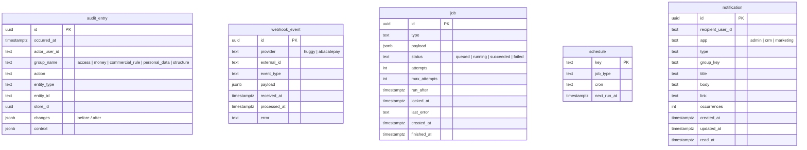

# SmartCorbans — Modelo de dados · Apoio (Auditoria, Webhooks, Jobs, Notificações)

**Status:** Validado
**Versão:** 0.2
**Data:** 11/10/2026
**Schemas:** `audit`, `integration`, `jobs`, `notifications`
**Base:** spec RNF005; ADR-0008, ADR-0011, ADR-0012; Shell Privado v0.5 §6; Marketing RN-MKT-10; CRM · Chat RN-CHT-04

## Histórico de revisões

| Versão | Mudanças |
|---|---|
| 0.2 | **Sino único por usuário** (ADR-0025): `app` é a aplicação de origem, usada no selo e no link, não para filtrar. |
| 0.1 | Primeira versão. |

## 1. O que cada schema guarda

| Schema | Componente da API | Conteúdo |
|---|---|---|
| `audit` | Auditoria | Trilha imutável das ações críticas (RNF005). |
| `integration` | Webhooks | Eventos recebidos da Huggy e do AbacatePay, para idempotência e reprocessamento (ADR-0011). |
| `jobs` | Jobs | Fila e agendamentos consumidos pelo Worker (ADR-0008). |
| `notifications` | Tempo real / Shell | Itens do sino, por destinatário (Shell Privado §6). |

## 2. Diagrama

## 3. Tabelas

### 3.1. `audit.audit_entry`

**Append-only**, protegida no banco: o papel da API só tem `INSERT` e `SELECT` (RNF005: nada é alterado nem apagado). Uma linha por ação crítica, com o conteúdo que o RNF005 exige: autor, data e hora, grupo, ação, item afetado (tipo e id), **antes e depois** dos campos alterados (`changes`, `jsonb`) e a Loja, quando houver. Na exportação, `context` guarda o tipo e os filtros (RN-REL-05). Gravada **na mesma transação** da ação, pelo componente Auditoria. Índices: `(entity_type, entity_id)`, `(actor_user_id, occurred_at)`, `(store_id, occurred_at)`. Sem tela na v1; o suporte consulta direto.

### 3.2. `integration.webhook_event`

Todo webhook recebido, já validado na origem. **Único por `(provider, external_id)`**: o repetido é aceito e ignorado (ADR-0011). `processed_at` e `error` mostram o que foi tratado; o pesado vira job. O `payload` é o corpo recebido, para reprocessar em caso de erro. Mensagens do Chat **não** são gravadas aqui: do evento de mensagem fica só o id e o tipo, e o `payload` é descartado depois do processamento, para não guardar conteúdo de conversa (Chat v0.8).

### 3.3. `jobs.job` e `jobs.schedule`

`job`: fila com trava por linha (`FOR UPDATE SKIP LOCKED`), novas tentativas com `attempts`/`max_attempts`/`run_after`, falha final registrada em `last_error` (ADR-0008). Enfileirado na mesma transação do dado de negócio. `schedule`: agendamentos fixos (Varredura Recorrente às 00h de Brasília, expiração de cobranças Pix, drenagem de Times e Funis). **Se a fase de esqueleto escolher uma biblioteca sobre o PostgreSQL (como o Hangfire), as tabelas dela substituem estas**, sem mudar a decisão.

### 3.4. `notifications.notification`

Uma linha **por destinatário** (o sino é pessoal e **único entre as três aplicações**, ADR-0025), com tipo, título, texto, o `link` para onde a ação acontece (Shell §6) e `app`, a aplicação de origem: serve ao **selo** do item e a montar o link, **não a filtrar**. `read_at` alimenta o indicador de não lidas. **`group_key` agrega** eventos repetidos numa linha só, somando `occurrences` e atualizando `updated_at`: por exemplo, várias mensagens novas na mesma conversa (RN-CHT-04) viram um item "3 mensagens novas de Fulano", e não três. Índice: `(recipient_user_id, read_at, updated_at DESC)`. Entrega em tempo real pelo SignalR (ADR-0010, ADR-0015); a tabela é o que sobrevive à sessão.

Catálogo de eventos de cada aplicação: Marketing RN-MKT-10 (três eventos), CRM RN-CHT-04 (mensagem nova). Os demais, definidos na documentação de cada aplicação.

## 4. Decisões deste modelo

1. **Auditoria num schema próprio, append-only no banco**, gravada na transação da ação.
2. **Caixa de entrada de webhooks** com unicidade por provedor e id, sem guardar conteúdo de mensagem do Chat.
3. **Jobs em tabela própria até a escolha da biblioteca**, que pode substituí-la.
4. **Notificação por destinatário, com agregação**, para o sino não virar ruído com mensagens de chat.
5. **Sem prazo de retenção** definido para notificações e webhooks; fica para quando o volume pedir.
